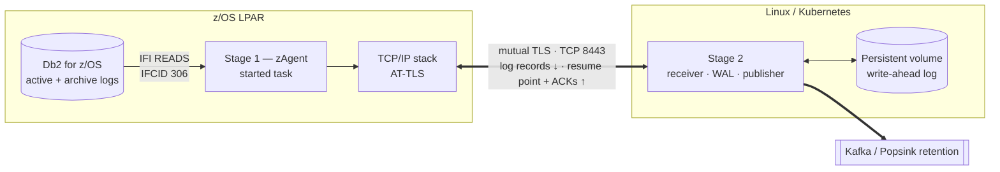
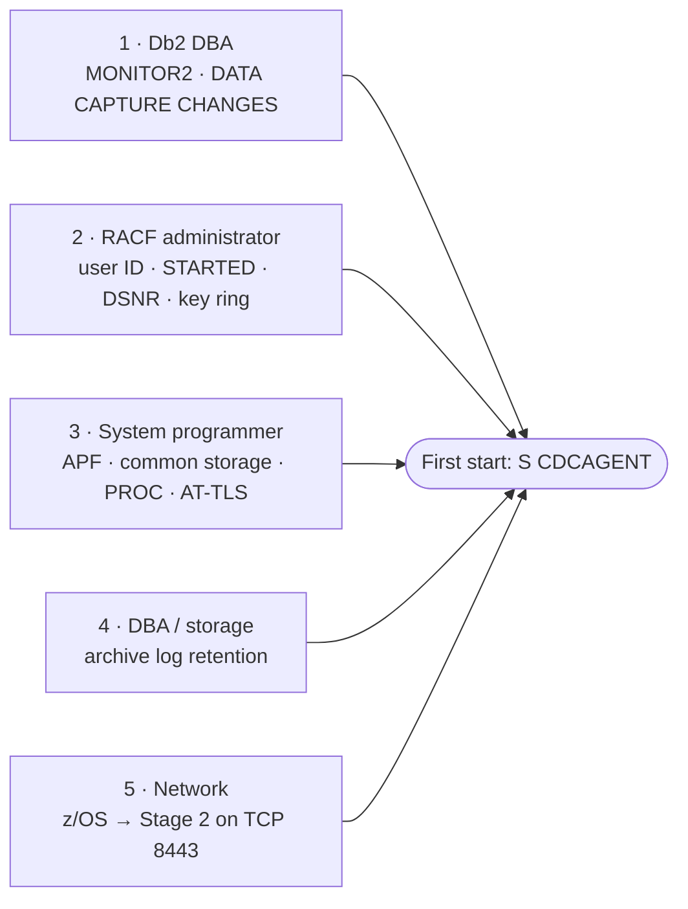
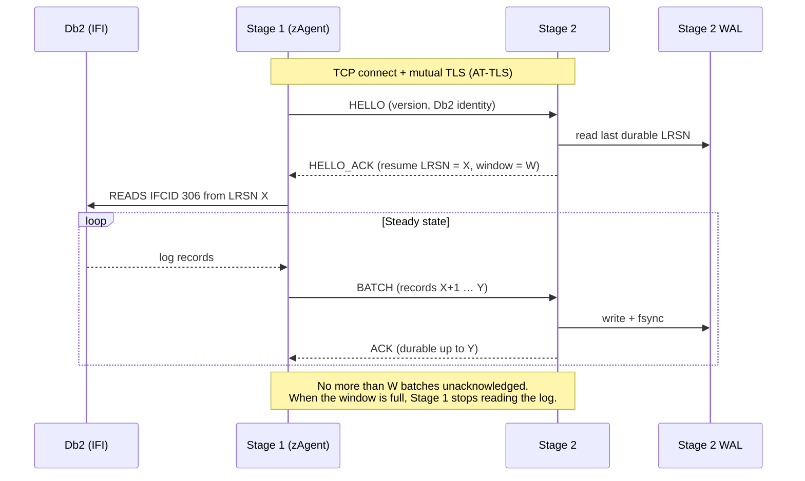
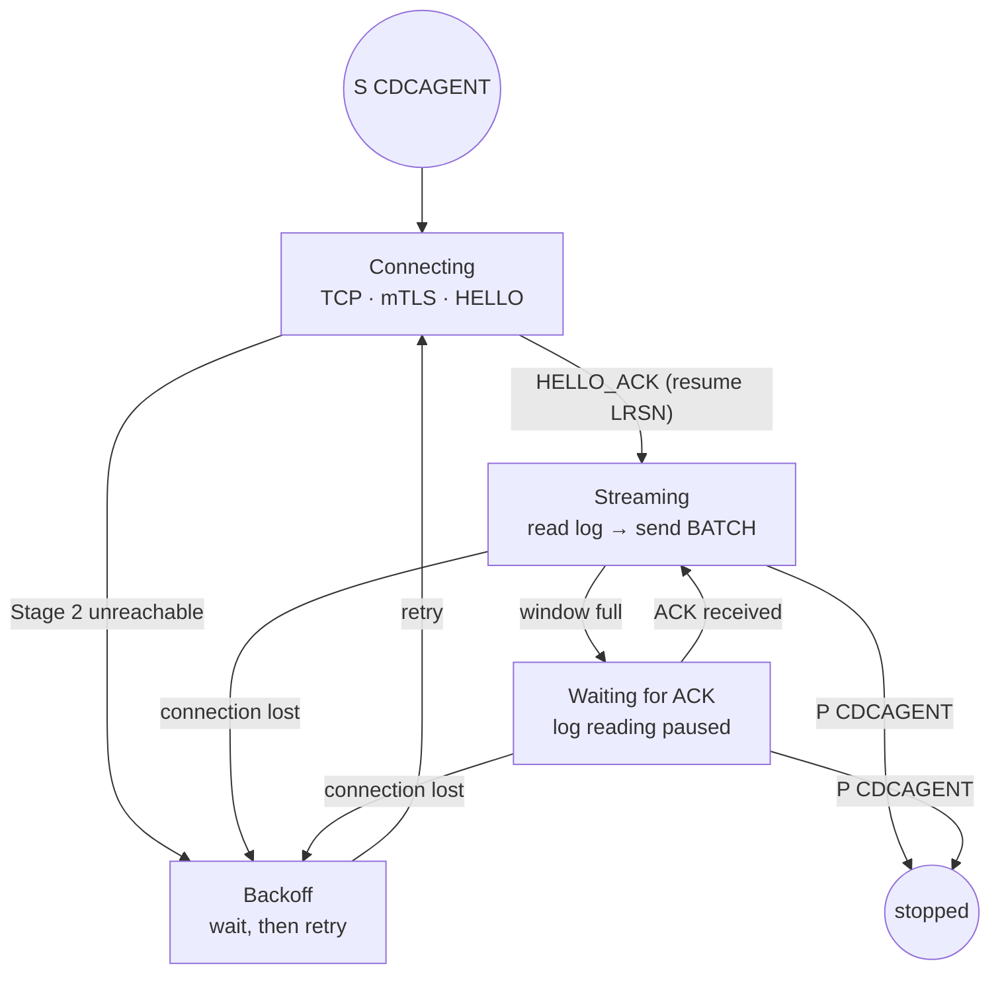

The IBM Z Source Connector captures changes (INSERT, UPDATE, DELETE) from **Db2 for z/OS** by reading the Db2 log. It uses a **split architecture**, so that almost all processing runs off the mainframe:

- **Stage 1 — zAgent**, a small, stateless started task on z/OS that reads the Db2 log and streams it out unchanged.
- **Stage 2 — processing server**, which runs off-host on Linux, stores the stream durably and publishes it to Kafka.

## Compatible versions

| | |
|---|---|
| **IBM Z / z/OS** | Confirmed per deployment |
| **Db2 for z/OS** | Log capture through the Instrumentation Facility Interface (IFI, IFCID 306) |
| **Stage 1 runtime** | z/OS started task, C / Language Environment, APF-authorized load module |
| **Stage 2 runtime** | Linux x86_64 or arm64 (VM, Kubernetes or OpenShift), Java 17+ |
| **Deployment** | Popsink Self-Hosted only |

<Note>This connector runs an agent inside your mainframe environment, so supported z/OS and Db2 for z/OS levels, including the required Db2 maintenance (APARs), are validated with you during onboarding. Get in touch with your release levels before planning a deployment.</Note>

## Overview

| | **Stage 1: zAgent** | **Stage 2: processing server** |
|---|---|---|
| Runs on | z/OS LPAR, as a started task | Linux (VM or Kubernetes) |
| Role | Reads the Db2 log and streams it out, unchanged | Stores the stream durably, processes it, publishes to Kafka |
| State | **None.** No checkpoint, no spool, no local files | All state: write-ahead log, resume point |
| Db2 access | Read-only, through the Db2 monitor interface (IFI) | None for capture |
| Network | **One outbound TLS connection** to Stage 2 | Listens for Stage 1, connects to Kafka |
| Authorization | APF-authorized load module (required by Db2 for IFCID 306) | None on z/OS |
| MIPS impact | Minimal: read, frame, send | None (off-host) |



### Design principles

- **Stage 1 does as little as possible.** It never decodes, filters or transforms data. This keeps it small, easy to audit and cheap in MIPS.
- **The Db2 log is the buffer.** If Stage 2 is unavailable, Stage 1 stops reading and waits. Nothing is spooled on z/OS, and nothing is lost as long as Db2 keeps the log (see [Archive log retention](#step-4-dba-and-storage-archive-log-retention)).
- **Stage 2 owns the resume point.** At every (re)connection, Stage 2 tells Stage 1 where to resume. Restarting the agent is always safe.
- **No change is acknowledged until it is on disk.** Stage 2 acknowledges a batch only after it is written and fsync'd to its write-ahead log.

## The z/OS agent (Stage 1)

### What it is

- A single-threaded **C program** (Language Environment), delivered as a **load module in a PDSE**.
- The load library must be **APF-authorized**. Db2 requires IFCID 306 calls to be made in supervisor state and key 0, with the return area in common storage. A small assembler routine switches to that state for the duration of each IFI call only; the rest of the program runs in normal problem state.
- It runs as a **started task** under a dedicated user ID (called `CDCAGENT` on this page).
- You run **one agent per Db2 subsystem**, or **one agent per data-sharing group**. In data sharing, the agent connects to one member and Db2 returns the log records of all members merged in LRSN order.
- It connects to Db2 with the **Call Attachment Facility** (CAF, `DSNALI`) and reads the log with the **Instrumentation Facility Interface** (`DSNWLI`, `READS` request for **IFCID 306**) — the standard Db2 interface for log-based replication.

### What it reads and writes

| Resource | Access | Purpose |
|---|---|---|
| Db2 log records, through IFI `READS` IFCID 306 | Read | The change data. Db2 returns only records for tables defined with `DATA CAPTURE CHANGES`, plus unit-of-recovery records (begin, commit, abort). |
| Db2 archive logs | **None directly** | IFCID 306 reads archived records itself, under Db2's own authority. The agent never opens a log data set. |
| Db2 tables and catalog | **None** | The agent runs no SQL. |
| Configuration file (USS file or PDS member) | Read | Db2 subsystem name, Stage 2 host and port, optional tuning |
| SYSOUT / USS log file | Write | Operational messages |
| Common storage (ECSA key 7) | Obtain / free | The IFI return area (200 KB to 1 MB), required by Db2 for IFCID 306. Obtained at start, freed at stop — also on an abnormal end, by a recovery routine. |
| Checkpoint, spool, VSAM, local data files | **None** | The agent is stateless. |
| Certificates and private key | **None directly** | Held in a RACF key ring and used by AT-TLS in the TCP/IP stack, not by the program |

The agent **never writes to Db2** and **never stores change data on z/OS**.

### Footprint

- **CPU:** read the log, wrap records in batches, send. No decoding, conversion or compression on z/OS.
- **Memory:** a few in-flight batches (`window × batch_max_kb`, see [Configuration](#configuration)).
- **Disk:** none apart from SYSOUT.
- **Common storage:** one IFI return area of 200 KB to 1 MB in ECSA (key 7).
- **Db2:** one CAF thread, and monitor trace class 1 if your Db2 level requires it.

## Prerequisites: what to request from your teams

Steps 1 to 5 are required before the first start. Each step can be sent as is to the team concerned.



### Step 1. Db2 DBA: privileges and table settings

| # | Request | Command | Why |
|---|---|---|---|
| 1a | Grant the monitor privilege to the agent user | `GRANT MONITOR2 TO CDCAGENT;` | Required for IFI `READS` of IFCID 306 (reading the log). It gives **no access to table data through SQL**. |
| 1b | Provide a plan for the agent's CAF connection | `BIND PLAN(ZAGENT) ...` for user `CDCAGENT` | The agent opens its Db2 connection with CAF `CONNECT` then `OPEN`, which names a plan. The plan contains no SQL. Depending on your Db2 level, `CONNECT` alone may be sufficient — Popsink confirms this with you. |
| 1c | Enable change capture on every table to replicate | `ALTER TABLE <schema>.<table> DATA CAPTURE CHANGES;` | Db2 then logs full row images for updates, and IFCID 306 returns records for these tables. |
| 1d | Give the list of tables in scope | — | Used for 1c and for the Stage 2 configuration |
| 1e | Give the Db2 version, function level, maintenance level, SSID and data-sharing topology | — | Agent configuration, and validation against the required APARs (several IBM fixes concern IFCID 306 log reads, for example PH38516) |
| 1f | Keep **monitor trace class 1** active, if your Db2 level requires it | `-START TRACE(MON) CLASS(1)`, or `MON=YES` in DSNZPARM so that it starts with Db2 | IFI `READS` requests can be refused when monitor class 1 is inactive. Class 1 has minimal overhead. |
| 1g | Tell us which captured tables are **compressed**, and how REORG handles their dictionaries | — | Db2 decompresses log records with the current dictionary. If REORG builds a new one, older log records may no longer decompress. On Db2 13 (FL 500, APAR PH64099), dictionaries can be kept in the compression dictionary data set (CDDS). |

<Warning>**Impact of `DATA CAPTURE CHANGES`:** it increases log volume for **updates** on the tables concerned, because Db2 logs the full before-image of the row instead of only the changed bytes. Inserts and deletes are not affected. Plan active and archive log capacity accordingly. It also blocks some `ALTER` operations while it is on, as documented by IBM.</Warning>

### Step 2. RACF administrator: identity and access

```text
/* Group and user, with an OMVS segment (the agent uses z/OS UNIX services) */
ADDGROUP CDCGRP  OMVS(GID(9001))
ADDUSER  CDCAGENT DFLTGRP(CDCGRP) OMVS(UID(9001) HOME('/var/cdcagent')) NOPASSWORD

/* Started task mapping */
RDEFINE STARTED CDCAGENT.* STDATA(USER(CDCAGENT) GROUP(CDCGRP))
SETROPTS RACLIST(STARTED) REFRESH

/* Db2 connection through CAF, only if the DSNR class is active */
PERMIT DB2P.BATCH CLASS(DSNR) ID(CDCAGENT) ACCESS(READ)
SETROPTS RACLIST(DSNR) REFRESH
```

Key ring for AT-TLS — the Stage 1 client certificate, plus the CA that signed the Stage 2 server certificate:

```text
RACDCERT ID(CDCAGENT) ADDRING(CDCRING)
RACDCERT ID(CDCAGENT) GENCERT SUBJECTSDN(CN('zagent-db2p') O('<Your organization>')) -
         WITHLABEL('ZAGENT-CLIENT') SIGNWITH(CERTAUTH LABEL('<Your CA>'))
RACDCERT ID(CDCAGENT) CONNECT(ID(CDCAGENT) LABEL('ZAGENT-CLIENT') RING(CDCRING) DEFAULT)
RACDCERT ID(CDCAGENT) CONNECT(CERTAUTH LABEL('<Stage 2 CA>') RING(CDCRING))
SETROPTS RACLIST(DIGTCERT DIGTRING) REFRESH
```

The user also needs READ on `IRR.DIGTCERT.LISTRING` in the `FACILITY` class (or an `RDATALIB` profile) to read its own key ring.

**What `CDCAGENT` cannot do:** run SQL, change any data, read data sets other than its own load library and configuration, start or stop Db2, or accept inbound connections.

**Authorized code:** the agent is APF-authorized because Db2 requires it for IFCID 306. Supervisor state is used only inside the IFI call routine and to obtain and free the return area. Popsink can provide this routine's design and source for review by your security team.

### Step 3. System programmer: installation

| # | Task |
|---|---|
| 3a | Install the load module (PDSE) from the Popsink distribution. It is link-edited with `AC(1)`. |
| 3b | Create the configuration file `/etc/cdcagent/zagent.conf` (owner `CDCAGENT`, mode 640) — see [Configuration](#configuration) |
| 3c | Add the started task procedure `CDCAGENT` — see [Started task](#started-task) |
| 3d | **APF-authorize** the load library (`PROGxx`, or `SETPROG APF,ADD` until the next IPL), and check that Db2 `SDSNLOAD` is APF-authorized |
| 3e | Check that common storage is sufficient: one IFI return area of 200 KB to 1 MB per agent, in ECSA (key 7) |
| 3f | Define the **AT-TLS policy** for outbound connections from job `CDCAGENT` to Stage 2 port 8443 (see [sample](#sample-at-tls-policy)) and refresh the Policy Agent |
| 3g | If `SERVAUTH` network access control is active, permit `CDCAGENT` to reach the Stage 2 network zone |
| 3h | Optional: add the task to your automation product (start after Db2, stop before Db2) |

### Step 4. DBA and storage: archive log retention

This is the **key availability requirement**. When Stage 2 is unreachable, the agent stops reading and later resumes from where Stage 2 left off. The log records it still needs **must still be available in Db2**: on the active log, or on archive logs that Db2 can read without operator action.

<Warning>**Rule:** archive log retention ≥ **longest planned Stage 2 outage** + safety margin. Recommended minimum: **72 hours**, so that a weekend outage is covered.</Warning>

| Question for the DBA | Why it matters |
|---|---|
| How long are archive logs kept, and where (DASD or tape)? | Logs older than the retention period cannot be replayed. |
| Can tape archives be recalled without operator intervention? | A tape mount request blocks capture during catch-up. Keeping the retention window on DASD also avoids a known IBM issue when the compression dictionary is on the same tape as the log (APAR PI67145). |
| What is the peak log rate (MB/s), for example during batch windows? | Sizing for the network link and for Stage 2 |

If the resume point is no longer available in Db2, the agent stops with an explicit error. Capture then has to be re-initialized from a new position, with a re-snapshot of the affected tables.

### Step 5. Network team

| Source | Destination | Port | Notes |
|---|---|---|---|
| z/OS LPAR IP (TCP/IP stack used by `CDCAGENT`) | Stage 2 address (or TCP load balancer VIP) | TCP 8443 (configurable) | Long-lived connection. TCP pass-through only. |

- Stage 1 is always the TCP client. **No inbound connection to z/OS** is needed: the agent opens no listening port, and Stage 2 never connects to the mainframe.
- Any firewall, NAT or load balancer between the two must **pass TCP straight through** — no TLS termination, no TLS inspection, no HTTP proxy — so that mutual TLS works end to end.

### Ready-to-send summary for the DBA

<Accordion title="Email template">
  > **Subject: Db2 prerequisites for Popsink zAgent (CDC) on `<SSID>`**
  >
  > We are installing Popsink zAgent, a log-based change data capture agent for Db2 for z/OS. It reads the Db2 log through the standard IFI interface (IFCID 306), runs no SQL and does not change any data. We need:
  >
  > 1. `GRANT MONITOR2 TO CDCAGENT;` and a plan for the agent's CAF connection (`BIND PLAN(ZAGENT) ...`, unless `CONNECT` alone is sufficient on your Db2 level).
  > 2. `ALTER TABLE … DATA CAPTURE CHANGES;` on the attached list of tables, at a time you choose (it increases update log volume on these tables).
  > 3. Confirmation that archive logs are kept for at least **72 hours** and can be read by Db2 without operator intervention, plus the peak log rate in MB/s.
  > 4. The Db2 version, function level and maintenance level, the SSID, and the data-sharing topology.
  > 5. Monitor trace class 1 active (`-START TRACE(MON) CLASS(1)`, or `MON=YES` in DSNZPARM), if your Db2 level requires it for IFI `READS`.
  > 6. Which of the attached tables are compressed, and how REORG handles their compression dictionaries.
  >
  > The agent's load library is APF-authorized, as Db2 requires for IFCID 306. RACF, system programming (APF, started task) and network requests are sent separately to the relevant teams.
</Accordion>

## Configuration

The configuration is deliberately small. Partitioning, topics and Kafka settings are configured **only** in Stage 2.

```ini
; /etc/cdcagent/zagent.conf  (illustrative)
[db2]
subsystem      = DB2P              ; Db2 SSID, or group attach name (the stream identity in Stage 2)
plan           = ZAGENT            ; plan used by the CAF OPEN
data_sharing   = yes               ; yes: log positions are LRSNs of the merged group log
member         = DB1A              ; informational: the member the agent attaches to

[stage2]
host           = stage2.example.com   ; must match the Stage 2 certificate
port           = 8443

[tuning]                           ; all optional, defaults shown
batch_max_kb   = 1024              ; maximum batch size sent to Stage 2 (1..16384)
batch_linger_ms = 100              ; longest wait before a partial batch is sent
ping_interval_s = 10               ; keep-alive and lag report when the log is quiet
ack_timeout_s  = 30                ; no answer from Stage 2 for this long: reconnect
reconnect_delay_s = 5              ; delay before reconnecting, doubles up to 60 s
; start_position = 00D92C1F8A3E5B120000   ; first start only; default: current end of the log
```

| Setting | Description |
|---|---|
| `batch_max_kb` | A batch is sent when it reaches this size, or when `batch_linger_ms` has elapsed with data pending. Larger batches mean fewer messages and fewer IFI-to-network round trips. The Stage 2 limit (16 MiB by default) must be at least as large. |
| Window | The number of batches the agent may have sent without acknowledgement. It is **not** set here: Stage 2 sends it in its handshake reply (default 8). Memory used on z/OS is about `window × batch_max_kb`. |
| `start_position` | Used only when Stage 2 holds no data for this stream (first start, or after a re-initialization). Otherwise, Stage 2's resume point always wins. |

There are no certificate paths: TLS is set up in the AT-TLS policy. Unknown keys are rejected at startup.

## Started task

**Procedure** (illustrative, member `CDCAGENT` in `SYS1.PROCLIB` or equivalent):

```jcl
//CDCAGENT PROC CONF='/etc/cdcagent/zagent.conf'
//*-------------------------------------------------------------
//* Popsink zAgent - Db2 log capture for DB2P
//*-------------------------------------------------------------
//AGENT    EXEC PGM=ZAGENT,REGION=0M,TIME=NOLIMIT,
//         PARM='POSIX(ON),ENVAR("_CEE_RUNOPTS=FILETAG(AUTOCVT)")/&CONF'
//* Every STEPLIB library must be APF-authorized
//STEPLIB  DD DISP=SHR,DSN=POPSINK.ZAGENT.LOAD
//         DD DISP=SHR,DSN=DSNC10.SDSNLOAD
//SYSOUT   DD SYSOUT=*
//SYSPRINT DD SYSOUT=*
//CEEDUMP  DD SYSOUT=*
```

<Warning>`POPSINK.ZAGENT.LOAD` and **every** other library in `STEPLIB` must be APF-authorized. If one of them is not, the step runs unauthorized and the IFI call fails.</Warning>

### Operator commands

| Action | Command | Effect |
|---|---|---|
| Start | `S CDCAGENT` | Connects to Db2, connects to Stage 2, gets the resume point, starts streaming |
| Stop | `P CDCAGENT` | Stops reading, waits for the acknowledgement of the batches in flight, closes the Stage 2 connection, disconnects from Db2. Nothing to save. |
| Emergency stop | `C CDCAGENT` | Safe, because the agent holds no state. Stage 2 resumes from its last durable point. |
| Status, lag, throughput | Stage 2 metrics — see [Monitoring](#monitoring) | The agent has no console command or metrics port by design. It writes a periodic `stats:` line to SYSOUT. |

### Return codes

| Code | Meaning |
|---|---|
| 0 | Stopped normally |
| 1 | Configuration or startup error (message in SYSOUT) |
| 2 | Stage 2 refused the Db2 identity: Stage 2 already stores another subsystem's stream. Configuration problem — the agent does not retry. |
| 3 | Log source error, for example the resume position is no longer in the Db2 log |

A lost Stage 2 connection or a failed Db2 attach is not an error exit: the agent retries with an increasing delay.

### Startup sequence

<Steps>
  <Step title="Read the configuration" />
  <Step title="Connect to Db2">CAF `CONNECT` / `OPEN`.</Step>
  <Step title="Connect to Stage 2">Open the TCP connection. AT-TLS performs the mutual TLS handshake.</Step>
  <Step title="Handshake">Send `HELLO` (protocol version, Db2 identity) and receive `HELLO_ACK` with the **resume LRSN**.</Step>
  <Step title="Stream">Position the IFI read at that LRSN and start the read → batch → send loop.</Step>
</Steps>

## How Stage 1 and Stage 2 communicate

### Security: AT-TLS and mutual TLS

- The connection is encrypted with **TLS 1.3** and **mutually authenticated**: Stage 1 checks the Stage 2 server certificate, and Stage 2 checks the Stage 1 client certificate. Stage 2 only accepts client certificates signed by the configured CA.
- On z/OS, TLS is provided by **AT-TLS** (Application Transparent TLS) in the TCP/IP stack, set up by a Policy Agent rule and a RACF key ring. The agent itself contains **no cryptographic code and no certificate files**. Your existing z/OS security controls (RACF, ICSF, Policy Agent) apply as for any other application.

### Protocol

A simple, versioned binary protocol over one TCP connection. Every message is a 4-byte big-endian length, a 1-byte type, and a body.

| Message | Direction | Content |
|---|---|---|
| `HELLO` | Stage 1 → Stage 2 | Protocol version, Db2 identity (subsystem / group, member), agent version |
| `HELLO_ACK` | Stage 2 → Stage 1 | **Resume LRSN** — the highest log position durably stored in Stage 2 — and the flow-control window |
| `BATCH` | Stage 1 → Stage 2 | Consecutive Db2 log records in log order, each with its LRSN, plus a checksum |
| `ACK` | Stage 2 → Stage 1 | **Cumulative**: "everything up to LRSN *X* is durably stored" |
| `PING` | Stage 1 → Stage 2 | Current end of the Db2 log, sent when the agent has nothing to send. Stage 2 answers with an `ACK` and derives the capture lag from it. |
| `CLOSE` | Stage 1 → Stage 2 | Orderly stop (`P CDCAGENT`) |
| `ERROR` | Stage 2 → Stage 1 | Reason for closing the connection (protocol error, checksum, storage, replaced by a newer agent, shutdown) |



### Delivery guarantees

| Property | How it is guaranteed |
|---|---|
| **No data loss** | Stage 2 sends an ACK only after fsync. Stage 1 keeps nothing, and on reconnection it always resumes from Stage 2's durable position. The Db2 log holds everything after that position. |
| **Order** | One stream in Db2 log order (LRSN). Nothing is reordered in transit. |
| **No duplicates in Stage 2** | Records at or below the durable LRSN are ignored, so a re-sent batch is harmless. |
| **Backpressure** | A window of unacknowledged batches. If Stage 2 or Kafka slows down, Stage 1 reads the log more slowly. Nothing builds up on z/OS. |
| **Integrity** | TLS, plus a checksum per batch. A corrupt batch closes the connection, and the stream resumes from the last ACK. |

### When Stage 2 is unavailable

A reconnection is the same as a fresh start: `HELLO`, then `HELLO_ACK` with the resume point, then streaming. There is no separate recovery mode.



## Stage 2

### Deployment

| Item | Requirement |
|---|---|
| Platform | Linux x86_64 or arm64: VM, or container on Kubernetes / OpenShift |
| Runtime | Java 17+, delivered as a container image or JAR |
| Storage | **Persistent, fsync-safe volume** for the write-ahead log (local SSD or block storage; **not NFS**). Size it for the longest Kafka outage you want to absorb. |
| High availability | Active/standby with the WAL on replicated block storage, or a Kubernetes StatefulSet with a persistent volume. **One active instance per Db2 stream.** |

### Durability

- Each batch received from Stage 1 is checked, written to the write-ahead log (WAL) and fsync'd, then acknowledged. This is the only step in Stage 1's critical path; publishing to Kafka happens asynchronously from the WAL.
- The WAL is the **only durable buffer** in the pipeline. It absorbs Kafka outages and slow consumers without slowing Db2. Once Kafka has confirmed delivery, the WAL is trimmed past the published position.
- If the WAL fills up (Kafka down for a long time), Stage 2 stops acknowledging. Stage 1 then stops reading, and the Db2 archive logs take over as the buffer. **Total protection = WAL capacity + Db2 archive log retention.**

### Network flows

| # | From | To | Port | Purpose | Required |
|---|---|---|---|---|---|
| 1 | z/OS (Stage 1) | Stage 2 | TCP 8443 | Change stream, mutual TLS | Yes |
| 2 | Stage 2 | Kafka brokers | Your Kafka listener | Publish | Yes |
| 3 | Monitoring | Stage 2 | TCP 8080 | `/actuator/health`, `/actuator/prometheus` | Recommended |

### Monitoring

The agent has no metrics endpoint by design: all capture metrics are exposed by Stage 2 in Prometheus format.

| Metric | Meaning |
|---|---|
| `cdc_stream_connected` (and health details) | Stage 1 connected / disconnected, since when, from which address |
| `durablePosition` (health details) | Durable LRSN: the resume point, last position safely stored |
| `cdc_stream_capture_lag` | **Capture lag**: current Db2 log position (from the agent's `PING`) minus the durable LRSN, as a difference of log positions |
| `cdc_stream_publish_lag` | Publish lag: durable LRSN minus the last LRSN published to Kafka |
| `cdc_stream_records_received_total`, `cdc_stream_bytes_received_total`, `cdc_publisher_records_published_total` | Throughput received and published |
| `cdc_wal_size_bytes`, `cdc_wal_records_estimate` | WAL usage |

<Tip>Recommended alerts: Stage 1 disconnected for more than N minutes; capture lag above a threshold; WAL more than 80% full; capture lag approaching the archive log retention period.</Tip>

## Operations and failure handling

| Event | What happens | Action |
|---|---|---|
| Stage 2 restart or crash | Stage 1 pauses and reconnects. Stage 2 resumes from its WAL. | None |
| Network outage | Same as above | None, as long as the outage is shorter than archive log retention |
| Kafka outage | Stage 2 keeps writing to its WAL. When the WAL is full, capture pauses. | Fix Kafka. Watch WAL usage. |
| Agent stopped (`P` or `C`) | Nothing is lost. On restart, Stage 2 provides the resume point. | `S CDCAGENT` |
| Db2 stopped or restarted | The agent loses its Db2 connection and ends | Restart the agent after Db2, ideally through automation |
| LPAR IPL | Same as a Db2 restart | Start the agent from automation |
| Outage longer than archive log retention | The agent stops with a "resume position no longer available" error | Re-initialize capture and re-snapshot — contact Popsink |
| New table to capture | `DATA CAPTURE CHANGES` + Stage 2 configuration | No agent change |

<Note>Initial load (a snapshot of the rows that already exist in the tables) is outside log capture and is planned with you during onboarding.</Note>

## Appendix

### Pre-installation checklist

| Item | Owner |
|---|---|
| `MONITOR2` granted to `CDCAGENT` | DBA |
| Plan for the CAF OPEN bound (or confirmed unnecessary) | DBA |
| `DATA CAPTURE CHANGES` on the tables in scope | DBA |
| Monitor trace class 1 active (if required) | DBA |
| Compressed tables and REORG dictionary handling identified | DBA |
| Db2 maintenance level checked against the required APARs | DBA / sysprog |
| Archive log retention ≥ 72 h, readable without operator action | DBA / storage |
| Db2 version, SSID, data-sharing topology, peak log rate provided | DBA |
| User `CDCAGENT` with OMVS segment, `STARTED` profile | RACF |
| `DSNR` `<ssid>.BATCH` READ (if DSNR is active) | RACF |
| Key ring `CDCRING` with client certificate and Stage 2 CA | RACF |
| Load module installed, PROC in PROCLIB, configuration file created | Sysprog |
| Load library and `SDSNLOAD` APF-authorized | Sysprog |
| Common storage (ECSA) available for the IFI return area | Sysprog |
| AT-TLS policy active | Sysprog / network |
| Firewall: z/OS → Stage 2 TCP 8443 | Network |
| Stage 2 deployed with a persistent volume, Kafka reachable | Platform team |
| Stage 2 server certificate issued (SAN = Stage 2 host name) | PKI |

### Sample AT-TLS policy

Illustrative Policy Agent configuration for the outbound connection from `CDCAGENT` to Stage 2:

```text
TTLSRule                       ZAGENT_TO_STAGE2
{
  Jobname                      CDCAGENT
  Direction                    Outbound
  RemoteAddrGroupRef           STAGE2_ADDR
  RemotePortRange              8443
  TTLSGroupActionRef           ZAGENT_GRP
  TTLSEnvironmentActionRef     ZAGENT_ENV
}
TTLSGroupAction                ZAGENT_GRP
{
  TTLSEnabled                  On
}
TTLSEnvironmentAction          ZAGENT_ENV
{
  HandshakeRole                Client
  TTLSKeyRingParms             { Keyring CDCAGENT/CDCRING }
  TTLSEnvironmentAdvancedParms
  {
    TLSv1.2                    Off
    TLSv1.3                    On              # Stage 2 accepts TLS 1.3 only
    ServerCertificateLabel     ZAGENT-CLIENT   # client certificate to present
  }
}
IpAddrGroup                    STAGE2_ADDR
{
  IpAddr { Addr 10.20.30.40 }
}
```

### Glossary

| Term | Meaning |
|---|---|
| **LRSN / RBA** | Log Record Sequence Number / Relative Byte Address: the position of a record in the Db2 log |
| **IFI** | Instrumentation Facility Interface: the Db2 API for traces and log reading |
| **IFCID 306** | IFI record type that returns Db2 log records for replication (`DATA CAPTURE CHANGES` tables) |
| **CAF** | Call Attachment Facility: how a batch or started-task program connects to Db2 |
| **MONITOR2** | Db2 privilege that allows IFI `READS` of log-related IFCIDs |
| **APF** | Authorized Program Facility: z/OS mechanism that lets a program from an authorized library use privileged functions such as supervisor state |
| **ECSA** | Extended common storage area, shared by all address spaces. Db2 places the IFCID 306 return area there. |
| **AT-TLS** | Application Transparent TLS: TLS done by the z/OS TCP/IP stack, set up by policy |
| **WAL** | Write-ahead log: Stage 2's durable buffer |
| **Unit of recovery** | A Db2 transaction, from first change to COMMIT or ROLLBACK |

### IBM references

| Topic | Reference |
|---|---|
| Reading log records with IFI (MONITOR2) | [IBM Docs, Db2 13](https://www.ibm.com/docs/en/SSEPEK_13.0.0/admin/src/tpc/db2z_readlogrecordifi.html) |
| Reading complete log data, IFCID 0306 (data sharing merge, decompression) | [IBM Docs](https://www.ibm.com/docs/en/SSEPEK_10.0.0/admin/src/tpc/db2z_readlogcomplete.html) |
| Return area for IFCID 0306 (supervisor state, key 0, common storage) | [IBM Docs, Db2 13](https://www.ibm.com/docs/en/SSEPEK_13.0.0/admin/src/tpc/db2z_specifylogrecordreturnarea.html) |
| Qualification fields (`WQALLMOD`, `WQALLRBA`, `WQALLOPT`, filtering) | [IBM Docs, Db2 13](https://www.ibm.com/docs/en/SSEPEK_13.0.0/admin/src/tpc/db2z_logrecordqualify.html) |
| READS authorization | [IBM Docs, Db2 13](https://www.ibm.com/docs/en/SSEPEK_13.0.0/perf/src/tpc/db2z_ifi_reads.html) |
| Compression dictionaries in CDDS for IFCID 0306 | [APAR PH64099](https://www.ibm.com/support/pages/apar/PH64099) |
| Compressed record on archive tape | [APAR PI67145](https://www.ibm.com/support/pages/apar/PI67145) |
