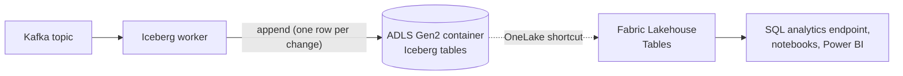

Popsink delivers your pipeline data to **Microsoft Fabric** in one of three ways. Pick the one that matches where your data must live and how your teams query it:

| Path | Connector | Data lands in | Choose it when |
|---|---|---|---|
| [**Lakehouse through a OneLake shortcut**](#lakehouse-through-a-onelake-shortcut) | [Iceberg](./iceberg) | Your own ADLS Gen2 account, exposed in a Lakehouse | You already have an Azure storage account and want open tables readable by any engine, Fabric included |
| [**Direct writes to OneLake**](#direct-writes-to-onelake) | [Iceberg](./iceberg) | The Lakehouse's own OneLake storage | Your data must stay inside Fabric, with no storage account of your own and no shortcut to maintain |
| [**Fabric Warehouse**](#fabric-warehouse) | [SQL Server](./mssql) | Tables of a Fabric Warehouse | Your teams model in T-SQL and want current-state tables they can modify |

The two Lakehouse paths write the source table's **change history** and read the current state through a view. The Warehouse path applies changes on the primary key, so the table holds the current state.

## Lakehouse through a OneLake shortcut

The worker writes Apache Iceberg tables to an Azure Data Lake Storage Gen2 container you own, and a **OneLake shortcut** exposes each table in a Fabric Lakehouse. Fabric reads Iceberg tables through a shortcut natively, so the tables are queryable from the Lakehouse's SQL analytics endpoint, notebooks, Spark jobs and Power BI, with no copy and no Fabric capacity spent on ingestion.

### How It Works



1. The [Iceberg target](./iceberg) writes one Iceberg table per subscription to your ADLS Gen2 container. Each change event is a row, so the table holds the source table's **change history**.
2. In the Lakehouse, you create one **shortcut per table**, pointing at the table's folder in the container.
3. Fabric reads the Iceberg metadata behind the shortcut and exposes the table under **Tables**. New commits show up without any action on your side.
4. A view collapses the history into the **current state**, one row per primary key. See [Current state](#current-state-of-a-lakehouse-table).

### Prerequisites

- An **Azure Data Lake Storage Gen2** account (hierarchical namespace enabled) and an existing container for the Iceberg data.
- An identity Popsink writes with: a **service principal** with the **Storage Blob Data Contributor** role on the storage account (recommended), or the account's key or connection string.
- A **Fabric workspace** on a Fabric capacity, with a **Lakehouse**, and a role in it that can create shortcuts (Contributor or above).
- An identity Fabric reads the container with: your organizational account, a service principal or the workspace identity, with at least **Storage Blob Data Reader** on the storage account.
- A **primary key** on each subscription whose current state you want to read: flag the key columns in the subscription's column mapping, or declare them on the datamodel.

<Note>If the storage account only accepts traffic from selected networks, allow both Popsink's [egress IPs](/deployment/connectivity/egress-ips) and Fabric (trusted workspace access, or a OneLake data gateway).</Note>

### Step 1 — Create the Iceberg target

In the console, open **Connectors → Targets**, click **New Target** and pick **Iceberg**. Every field is described on the [Iceberg target](./iceberg) page. The values that matter for Fabric:

| Field | Value |
|---|---|
| **Catalog** | **SQL catalog**. Fabric reads the table files directly and never queries the catalog, so the catalog hosted by your Popsink deployment is enough. |
| **Catalog Database URL** | Leave empty to use the hosted catalog. |
| **Warehouse** | `abfss://<container>@<account>.dfs.core.windows.net/<path>` |
| **Namespace** | e.g. `fabric` |
| **Storage Credentials** | **Static credentials of this connector** → **Azure Data Lake Storage Gen2** → **Service principal**: **Storage Account Name**, **Tenant ID**, **Client ID**, **Client Secret** |
| **Format version** | **v2**, the version Fabric's Iceberg shortcuts are documented for. |

Test the connection, save the target, then create a subscription for each source table you want in Fabric. Once the first batch is committed, each table has its own folder under the warehouse path, holding a `metadata/` and a `data/` folder.

### Step 2 — Create a shortcut per table

In the Fabric Lakehouse:

1. In the **Explorer**, open the menu of **Tables** and select **New shortcut**.
2. Pick **Azure Data Lake Storage Gen2**.
3. Enter the URL `https://<account>.dfs.core.windows.net`, then create or reuse a connection with the read identity from the prerequisites.
4. Browse to the **table's folder**, the one that contains `metadata/` and `data/`, and select it. Pointing at the namespace folder or at `metadata/` alone does not work: a shortcut under **Tables** must target exactly one table.
5. Name the shortcut after the table and create it.

The table appears under **Tables** after a short discovery delay, and it is available from the SQL analytics endpoint and the semantic model.

<Tip>Repeat the shortcut for every new subscription. A table added later to the pipeline is not exposed in Fabric until its shortcut exists.</Tip>

### Current state of a Lakehouse table

The Iceberg table is the change history: an update or a delete adds a row. To read one row per key, create a view in the Lakehouse's **SQL analytics endpoint** that keeps the latest change of each key and hides deleted keys. The rules are detailed under [Current state: the merge view](./iceberg#current-state-the-merge-view).

```sql T-SQL (SQL analytics endpoint)
CREATE VIEW dbo.orders_current AS
SELECT id, status, amount, __op, __ts_ms   -- list your columns: T-SQL has no SELECT * EXCEPT
FROM (
  SELECT
    *,
    ROW_NUMBER() OVER (
      PARTITION BY id
      ORDER BY __ts_ms DESC, __kafka_offset DESC
    ) AS _ppsk_rank
  FROM dbo.orders
) AS history
WHERE _ppsk_rank = 1
  AND (__op IS NULL OR __op <> 'd');
```

Replace `id` with your primary key columns, and drop the `__kafka_offset` tie-breaker if metadata columns are off on the subscription. Keep the delete filter **after** the ranking: filtering deletes first would bring a deleted row's previous version back.

### Limitations

- One shortcut per table, created by you. Popsink does not create or remove shortcuts: to avoid them, use [direct writes to OneLake](#direct-writes-to-onelake).
- Fabric exposes the table read-only: write to it through Popsink only.
- New commits reach Fabric after its own metadata refresh, so expect a delay on top of the worker's commit interval (10,000 rows or 60 seconds per table).
- Columns are never dropped or retyped by the Iceberg target. Nested records and arrays are written as JSON text. See the [Iceberg target limitations](./iceberg#limitations).
- The current-state view is created and maintained by you: the managed merge view is available on Snowflake only.

## Direct writes to OneLake

The [Iceberg target](./iceberg) writes the tables straight into the Lakehouse's OneLake storage, through OneLake's ADLS Gen2-compatible endpoint. No storage account of your own sits in between, and there is no shortcut to create: each subscription's table appears in the Lakehouse as soon as its first batch is committed.

### Prerequisites

- A **Fabric workspace** on a Fabric capacity, with a **Lakehouse**.
- A Microsoft Entra ID **service principal** with a client secret, added to the workspace with the **Contributor** role (or above).
- In the Fabric admin portal, **Service principals can use Fabric APIs** enabled for the service principal, or for a security group it belongs to.
- A **primary key** on each subscription whose current state you want to read.

### Configure the Iceberg target

| Field | Value |
|---|---|
| **Catalog** | **SQL catalog**, hosted by your Popsink deployment (leave **Catalog Database URL** empty) |
| **Warehouse** | `abfss://<workspace>@onelake.dfs.fabric.microsoft.com/<lakehouse>.Lakehouse/Tables` |
| **Namespace** | e.g. `popsink` |
| **Storage Credentials** | **Static credentials of this connector** → **Azure Data Lake Storage Gen2** → **Service principal**: **Tenant ID**, **Client ID**, **Client Secret**. Set **Storage Account Name** to `onelake`. |
| **Format version** | **v2** |

`<workspace>` and `<lakehouse>` are the names shown in Fabric, or their GUIDs, found in the Lakehouse URL (`/groups/<workspace-id>/lakehouses/<lakehouse-id>`). Use GUIDs if a name contains spaces or may be renamed.

Test the connection and save the target. The connection test writes and deletes a probe file in the Lakehouse, which confirms the service principal's workspace role.

### Querying the tables

Tables show up under the Lakehouse's **Tables**, after Fabric's metadata discovery. Query them from the SQL analytics endpoint, notebooks or Power BI, and create the [current-state view](#current-state-of-a-lakehouse-table) exactly as for the shortcut path.

### Limitations

- The service principal needs a workspace role: OneLake does not accept storage-account keys or connection strings.
- Table maintenance (compaction, snapshot expiry, orphan cleanup) runs against OneLake as it does on ADLS, and consumes no Fabric capacity.
- The other [Iceberg target limitations](./iceberg#limitations) apply.

## Fabric Warehouse

The [SQL Server target](./mssql) writes rows into the tables of a **Fabric Warehouse** through its SQL endpoint. Changes are applied on the primary key, so each table holds the current state of its source table, and the tables can be modified with T-SQL like any other Warehouse table.

### Prerequisites

- A **Fabric Warehouse** in a workspace on a Fabric capacity.
- A Microsoft Entra ID **service principal** with a client secret, added to the workspace with the **Contributor** role (or above). A Fabric Warehouse accepts Microsoft Entra ID authentication only.
- In the Fabric admin portal, **Service principals can use Fabric APIs** enabled for the service principal.
- A **primary key** on each subscription.

### Configure the SQL Server target

In the console, create a **SQL Server** target and pick the **Fabric Warehouse** flavour.

| Field | Value |
|---|---|
| **Host** | The Warehouse's SQL connection string host, from **Warehouse → Settings → SQL endpoint**: `<id>.datawarehouse.fabric.microsoft.com` |
| **Port** | `1433` |
| **Database** | The Warehouse name |
| **Authentication** | **Microsoft Entra ID service principal**: **Tenant ID**, **Client ID**, **Client Secret** |

Test the connection, save the target, and create the subscriptions. Each subscription creates its table in the Warehouse on first delivery.

### What is written

The Fabric Warehouse flavour creates tables with the types a Fabric Warehouse accepts:

| Source type | Fabric Warehouse type |
|---|---|
| String | `varchar(n)` (`varchar(8000)` when the length is unknown) |
| Integer, long | `int`, `bigint` |
| Decimal | `decimal(p, s)` |
| Float, double | `real`, `float` |
| Boolean | `bit` |
| Date | `date` |
| Timestamp | `datetime2(6)` |
| Bytes | `varbinary(n)` |

The primary key is declared `NONCLUSTERED NOT ENFORCED`, as Fabric requires: Popsink guarantees one row per key, the Warehouse does not check it. Inserts and updates are upserted on the key, and deletes remove the row. New source columns are added as nullable columns.

### Limitations

- Microsoft Entra ID authentication only: a SQL login cannot connect to a Fabric Warehouse.
- `nvarchar`, `datetimeoffset` and `IDENTITY` columns are not available in a Fabric Warehouse; text is stored as `varchar` (UTF-8 collation).
- Columns are never dropped or retyped.
- Writes consume the Fabric capacity of the Warehouse's workspace.
