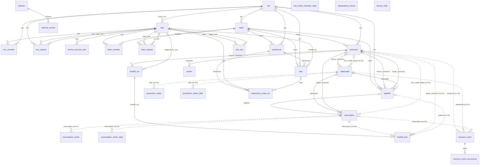
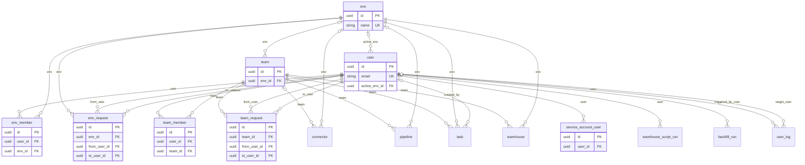
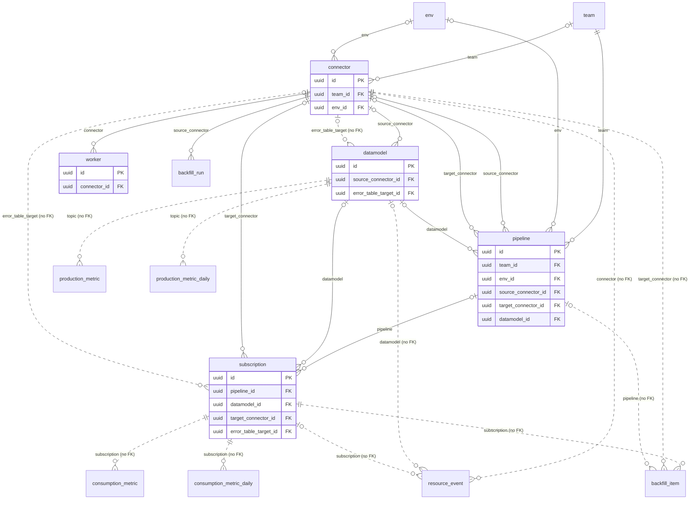
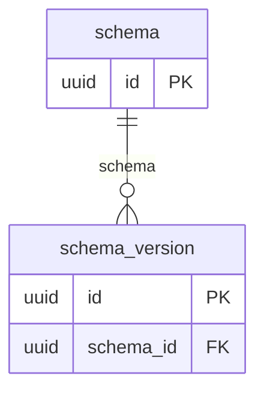
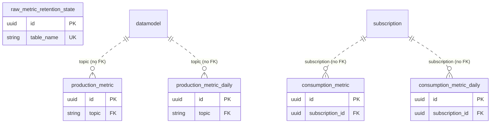
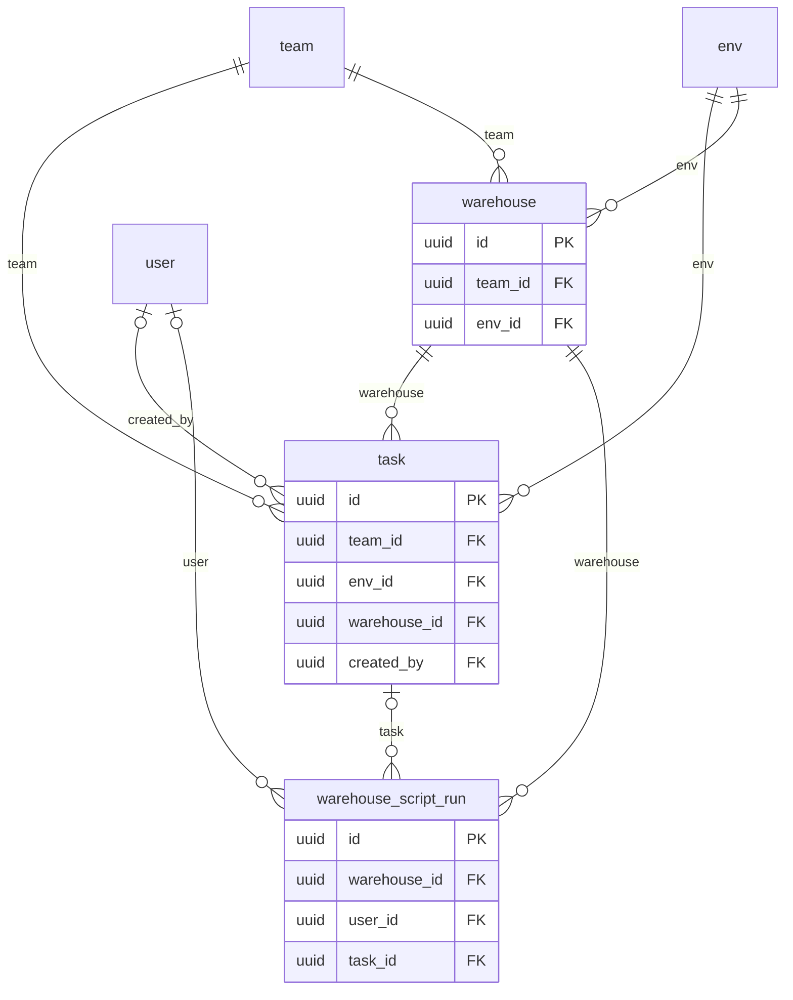
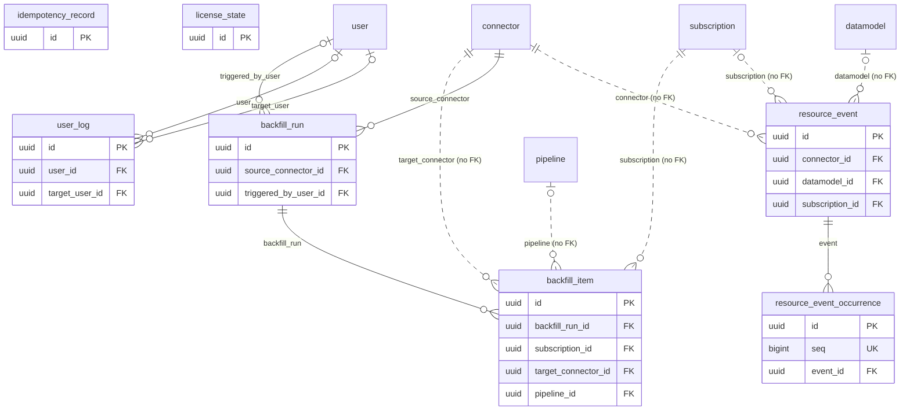

{/* Generated from the data-plane's SQLAlchemy models by `inv dp.dm`. Refresh it by copying data-plane/docs/data-model.mdx over this file — never by editing it here, which would make it disagree with the shipped schema at the next migration. */}

The data-plane keeps its own PostgreSQL database. It holds **configuration and operational records only** — which systems to read, how to shape what they produce and where to deliver it, plus who may change any of that. **Replicated data is never written here**: it travels source → broker → target, and no row of yours is copied into this database along the way. The one exception is quoted, not copied — a failure is stored as the system that raised it worded it, and such a message can name the row it refused. Every such column is named at the end of this document.

30 tables in 6 subject areas, 53 references between them.

## How to read this

- **An arrow points from the row holding the reference to the row it names.** `subscription → connector` means a subscription row stores the id of a connector row.
- **A dashed arrow is a reference with no foreign key behind it.** Always deliberate, and always for the same reason: the referenced row may be deleted while the referring row has to survive it. Every one is listed, with its reason, at the end of this document.
- **`PK` is the primary key, `FK` a reference, `UK` a value unique across the table.** Every table is keyed by a UUID v4 generated by the application, and carries `created_at` / `updated_at`.

## Map

## Access and organisation

Who may act, and on what. Environments hold teams, teams hold everything else, and membership in either is what every permission check reads.

### `env`

The top of the hierarchy: one environment, its teams, and the broker they share.

Environments are synchronised from the control-plane by UUID, which is why two data-planes must never share a database — the names would collide.

| Column | Type | Null | Description |
| --- | --- | --- | --- |
| `id` | `UUID` | required | Primary key: a UUID v4 generated by the application, never by the database. |
| `name` | `VARCHAR(100)` | optional | Env name. |
| `retention_configuration` | `JSON` | required | The environment's broker: bootstrap server, security protocol, retention, and — when the broker asks for them — the SASL credentials and TLS client certificate its workers authenticate with. Stored as given; nothing encrypts this column. |
| `config_hash` | `VARCHAR(64)` | optional | SHA-256 hash of deployment configuration (64 hex characters) |
| `created_at` | `DATETIME` | optional | When the record was created. |
| `updated_at` | `DATETIME` | optional | When the record was last updated. |

### `env_member`

A user's membership of an environment, and the role it grants there.

One row per (user, env): a duplicate makes every later permission check raise, which is why the write path takes an advisory lock rather than relying on a read-then-insert.

| Column | Type | Null | Description |
| --- | --- | --- | --- |
| `id` | `UUID` | required | Primary key: a UUID v4 generated by the application, never by the database. |
| `timestamp` | `DATETIME` | required | When the membership was granted. |
| `role` | `VARCHAR(16)` | required | Environment role: admin, member or reader (#3531). |
| `user_id` | `UUID` | required | The member. |
| `env_id` | `UUID` | required | The environment they are a member of. |
| `created_at` | `DATETIME` | optional | When the record was created. |
| `updated_at` | `DATETIME` | optional | When the record was last updated. |

References: `user_id` → `user.id`, `ON DELETE CASCADE`; `env_id` → `env.id`, `ON DELETE CASCADE`.

Indexed on: `(user_id, env_id)`.

### `env_request`

A pending join or invitation to an environment, and the role acceptance would grant.

The same row shape covers both directions: a user asking to join and an admin inviting differ only in who ``from_user_id`` is.

| Column | Type | Null | Description |
| --- | --- | --- | --- |
| `id` | `UUID` | required | Primary key: a UUID v4 generated by the application, never by the database. |
| `role` | `VARCHAR(16)` | required | Env role granted on acceptance: admin, member or reader (#3531). |
| `env_id` | `UUID` | required | Environment ID. |
| `from_user_id` | `UUID` | required | Request author (user or admin). |
| `to_user_id` | `UUID` | required | Target user of the request. |
| `status` | `VARCHAR(32)` | required | Request status. |
| `created_at` | `DATETIME` | optional | When the record was created. |
| `updated_at` | `DATETIME` | optional | When the record was last updated. |

References: `env_id` → `env.id`, `ON DELETE CASCADE`; `from_user_id` → `user.id`; `to_user_id` → `user.id`.

Indexed on: `(env_id)`; `(from_user_id)`; `(to_user_id)`.

### `service_account_user`

A named machine identity, backed by a real user row.

Its token carries both ids, and every permission check reads the user — the service account only gives the token a name and a lifetime of its own.

| Column | Type | Null | Description |
| --- | --- | --- | --- |
| `id` | `UUID` | required | Primary key: a UUID v4 generated by the application, never by the database. |
| `name` | `VARCHAR(300)` | required | Service account user name. |
| `user_id` | `UUID` | required | The user identity this service account acts as, and whose permissions it gets. |
| `created_at` | `DATETIME` | optional | When the record was created. |
| `updated_at` | `DATETIME` | optional | When the record was last updated. |

References: `user_id` → `user.id`, `ON DELETE CASCADE`.

### `team`

The unit of ownership: every pipeline and connector belongs to exactly one.

Team membership is what a write is authorized against, so a team is also the smallest thing two people can be given different access to.

| Column | Type | Null | Description |
| --- | --- | --- | --- |
| `id` | `UUID` | required | Primary key: a UUID v4 generated by the application, never by the database. |
| `name` | `VARCHAR(100)` | optional | Team name. |
| `description` | `TEXT` | optional | Team description. |
| `env_id` | `UUID` | optional | Environment the team lives in; connectors and pipelines mirror it (#2527). |
| `created_at` | `DATETIME` | optional | When the record was created. |
| `updated_at` | `DATETIME` | optional | When the record was last updated. |

References: `env_id` → `env.id`, `ON DELETE SET NULL`.

Unique together: (`env_id`, `name`).

### `team_member`

A user's membership of a team — the row every write permission check reads.

One row per (user, team), for the same reason ``EnvMember`` is: a duplicate makes every later check raise. An API key's memberships are derived from its grants and written here too, so authorization has one shape whoever the caller is.

| Column | Type | Null | Description |
| --- | --- | --- | --- |
| `id` | `UUID` | required | Primary key: a UUID v4 generated by the application, never by the database. |
| `timestamp` | `DATETIME` | required | When the membership was granted. |
| `admin` | `BOOLEAN` | optional | Whether the member administrates the team, rather than only working in it. |
| `user_id` | `UUID` | required | The member. |
| `team_id` | `UUID` | required | The team they are a member of. |
| `created_at` | `DATETIME` | optional | When the record was created. |
| `updated_at` | `DATETIME` | optional | When the record was last updated. |

References: `user_id` → `user.id`, `ON DELETE CASCADE`; `team_id` → `team.id`, `ON DELETE CASCADE`.

Indexed on: `(user_id, team_id)`.

### `team_request`

A pending join or invitation to a team, and whether acceptance would grant admin.

The same row shape covers both directions: a user asking to join and an admin inviting differ only in who ``from_user_id`` is.

| Column | Type | Null | Description |
| --- | --- | --- | --- |
| `id` | `UUID` | required | Primary key: a UUID v4 generated by the application, never by the database. |
| `admin` | `BOOLEAN` | required | Is admin request? |
| `team_id` | `UUID` | required | Team ID. |
| `from_user_id` | `UUID` | required | Request author (user or admin). |
| `to_user_id` | `UUID` | required | Target user of the request. |
| `status` | `VARCHAR(32)` | required | Request status. |
| `created_at` | `DATETIME` | optional | When the record was created. |
| `updated_at` | `DATETIME` | optional | When the record was last updated. |

References: `team_id` → `team.id`; `from_user_id` → `user.id`; `to_user_id` → `user.id`.

Indexed on: `(from_user_id)`; `(team_id)`; `(to_user_id)`.

### `user`

A person or machine identity that can act on this data-plane.

Also backs every service account: a service-account token carries both ids and every permission check reads the user, so there is no second identity table.

| Column | Type | Null | Description |
| --- | --- | --- | --- |
| `id` | `UUID` | required | Primary key: a UUID v4 generated by the application, never by the database. |
| `email` | `VARCHAR(320)` | required | Login and, for historical rows, the actor of record. |
| `hashed_password` | `VARCHAR(1024)` | optional | Argon2 hash of the local password. NULL is the marker for an identity that has none — control-plane and service-account users authenticate elsewhere. |
| `is_active` | `BOOLEAN` | required | Whether the identity may authenticate at all; deactivation is how a user is revoked without erasing the history they authored. |
| `is_superuser` | `BOOLEAN` | required | Bypasses the environment and team checks. |
| `is_verified` | `BOOLEAN` | required | Whether the email address was confirmed. |
| `version` | `INTEGER` | required | Bumped on every change, so the control-plane membership sync can tell which side is stale without comparing every field. |
| `active_env_id` | `UUID` | optional | Environment the UI last had selected. A preference, never an authorization. |
| `created_at` | `DATETIME` | optional | When the record was created. |
| `updated_at` | `DATETIME` | required | When the record was last updated. Unlike the inherited column this one is timezone-aware and indexed: the membership sync pages on it. |

References: `active_env_id` → `env.id`, `ON DELETE SET NULL`.

Indexed on: `unique (email)`; `(updated_at)`; `(version)`.

## Pipelines

The configured data flow itself: a source connector reads a system, a datamodel shapes what it produced, and a subscription delivers that into a target connector.

### `connector`

An integration point with one external system, read from or written to.

Whether it is a source or a target is derived from its type, never chosen; its configuration is encrypted at rest, so anything selecting ``json_configuration`` — even through a join — owes a decrypt (#3698). It runs on one worker per shard of its plan.

| Column | Type | Null | Description |
| --- | --- | --- | --- |
| `id` | `UUID` | required | Connector ID. |
| `name` | `VARCHAR(100)` | optional | Connector name. |
| `connector_type` | `VARCHAR(50)` | required | Connector specific type (Snowflake target, Job SMT, PostgreSQL source...). |
| `json_configuration` | `JSON` | required | Json connector definition. |
| `way` | `VARCHAR(6)` | required | Is the connector a source or a target? |
| `team_id` | `UUID` | optional | Team ID that owns this connector. |
| `env_id` | `UUID` | optional | Env ID this connector belongs to (mirrors team.env_id). _Mirrors team.env_id so the (env, name) uniqueness is one table's business (#2527)._ |
| `created_at` | `DATETIME` | optional | When the record was created. |
| `updated_at` | `DATETIME` | optional | When the record was last updated. |

References: `team_id` → `team.id`; `env_id` → `env.id`.

Unique together: (`env_id`, `name`).

Indexed on: `(lower(name))`.

### `datamodel`

The shape of what a source produced, and the topic it is republished on.

Sits between the raw CDC topic and the subscriptions: one datamodel feeds as many subscriptions as there are places the data has to land.

| Column | Type | Null | Description |
| --- | --- | --- | --- |
| `id` | `UUID` | required | DataModel ID. |
| `name` | `VARCHAR(100)` | required | DataModel name. |
| `config` | `JSON` | required | JSON configuration defining the data structure/schema. |
| `source_connector_id` | `UUID` | optional | Associated source connector ID. |
| `source_topic` | `VARCHAR(255)` | optional | Associated source topic to read from. |
| `target_topic` | `VARCHAR(255)` | optional | Associated target topic to write to. |
| `consumer_id` | `VARCHAR(255)` | optional | Consumer group ID for Kafka consumption. |
| `source_schema` | `VARCHAR(255)` | optional | Schema, library or namespace the source table belongs to, as the source spells it. NULL when the source has no such concept (MySQL, MongoDB, a dlt resource) or names no table at all (a Kafka topic). |
| `source_table` | `VARCHAR(255)` | optional | The source table this datamodel republishes, unqualified and unsanitised — unlike source_topic, which is the Kafka spelling. NULL for a source that consumes topics rather than tables. |
| `error_table_enabled` | `BOOLEAN` | optional | Associated error table enabled. |
| `error_table_name` | `VARCHAR(255)` | optional | Associated error table name. |
| `error_table_target_id` | `UUID` | optional | Associated error table target connector ID (None when no error table is configured). |
| `enabled` | `BOOLEAN` | optional | Whether this datamodel is enabled for processing. |
| `shard_index` | `INTEGER` | optional | Which pod of the source connector captures this table, 0-based. NULL until a start of the source places it; meanwhile no pod captures it, unless none of the source's tables is placed yet and its one pod captures them all. |
| `source_journal` | `VARCHAR(255)` | optional | The journal the source table is recorded in, qualified as LIBRARY.JOURNAL, as the source last reported it. IBM i only; NULL until a start lists the source. |
| `created_at` | `DATETIME` | optional | When the record was created. |
| `updated_at` | `DATETIME` | optional | When the record was last updated. |

References: `source_connector_id` → `connector.id`, `ON DELETE SET NULL`; `error_table_target_id` → `connector.id` (no foreign key: Optional pointer at the connector receiving rejected rows; unset on most datamodels.).

Indexed on: `(lower(name))`; `(source_connector_id, source_table)`.

### `pipeline`

One configured flow from a source connector to a target connector.

A pipeline has no state column of its own: what the UI shows is its worker's state, and "draft" is the computed absence of one — ``is_completed`` false with the worker paused.

| Column | Type | Null | Description |
| --- | --- | --- | --- |
| `id` | `UUID` | required | Pipeline ID. |
| `name` | `VARCHAR(100)` | optional | Pipeline name. |
| `json_configuration` | `JSON` | required | Json pipline definition. |
| `version` | `INTEGER` | required | Pipeline version. Incremented when the pipeline is modified. |
| `is_completed` | `BOOLEAN` | optional | Whether the pipeline configuration is complete (has subscription config). |
| `error_table_config` | `JSON` | optional | Error table configuration for the pipeline. |
| `team_id` | `UUID` | required | Attached team ID. |
| `env_id` | `UUID` | optional | Env ID this pipeline belongs to (mirrors team.env_id). _Mirrors team.env_id so the (env, name) uniqueness is one table's business (#2527)._ |
| `source_connector_id` | `UUID` | optional | Source connector ID. |
| `target_connector_id` | `UUID` | optional | Target connector ID. |
| `datamodel_id` | `UUID` | optional | Data model ID. |
| `created_at` | `DATETIME` | optional | When the record was created. |
| `updated_at` | `DATETIME` | optional | When the record was last updated. |

References: `team_id` → `team.id`; `env_id` → `env.id`; `source_connector_id` → `connector.id`; `target_connector_id` → `connector.id`; `datamodel_id` → `datamodel.id`.

Unique together: (`env_id`, `name`).

Indexed on: `(lower(name))`.

### `subscription`

One delivery: how a datamodel's rows are transformed and written into one target table.

Identified by (datamodel, target connector, target table) where the index below applies; where it does not, that triple names a set rather than a row (#4443).

| Column | Type | Null | Description |
| --- | --- | --- | --- |
| `id` | `UUID` | required | Subscription ID. |
| `name` | `VARCHAR(255)` | required | Name of the subscription. |
| `config` | `JSON` | required | JSON configuration for the subscription. |
| `transform_config` | `JSON` | required | JSON configuration for data transformations. |
| `pipeline_id` | `UUID` | optional | Associated pipeline ID. |
| `datamodel_id` | `UUID` | optional | Associated datamodel ID. |
| `target_connector_id` | `UUID` | optional | Associated target connector ID. |
| `error_table_enabled` | `BOOLEAN` | required | Associated error table enabled. |
| `error_table_name` | `VARCHAR(255)` | optional | Associated error table name. |
| `error_table_target_id` | `UUID` | optional | Associated error table target connector ID (UUID). |
| `target_table_name` | `VARCHAR(255)` | optional | Target table name for output data. |
| `consumer_id` | `VARCHAR(255)` | optional | Consumer group ID for Kafka consumer. Defaults to subscription ID if not provided. |
| `backfill` | `BOOLEAN` | optional | Reload trigger: when switched on, the subscription's consumer group is reset to earliest (#2965). Default aligned with the domain entity. |
| `enabled` | `BOOLEAN` | optional | Whether this subscription is enabled for processing. |
| `shard_index` | `INTEGER` | optional | Which pod of the target connector serves this subscription, 0-based. NULL until the target's next restart places it. |
| `requires_unique_destination` | `BOOLEAN` | required | Whether this subscription's destination is exclusive to it, which is the predicate of the unique index on (datamodel, target connector, target table). False for a target that legitimately delivers one source topic into one destination several times, such as a CRM object type reached through several different mappers. |
| `created_at` | `DATETIME` | optional | When the record was created. |
| `updated_at` | `DATETIME` | optional | When the record was last updated. |

References: `pipeline_id` → `pipeline.id`, `ON DELETE SET NULL`; `datamodel_id` → `datamodel.id`, `ON DELETE SET NULL`; `target_connector_id` → `connector.id`, `ON DELETE SET NULL`; `error_table_target_id` → `connector.id` (no foreign key: Optional pointer at the connector receiving rejected rows; unset on most subscriptions.).

Indexed on: `unique (datamodel_id, target_connector_id, target_table_name)`.

### `worker`

The execution state of one of a connector's pods — both what we want and what we observed.

``state`` carries the two at once: ``STOPPING`` is an intent, ``LIVE`` an observation, so every runtime write goes through ``Worker.accepts_reported_state()`` under a row lock. A heartbeat older than 90 s means the pod stopped reporting, not that it stopped.

One row is one *shard*: a connector holds as many as its plan needs, dense from index 0 (#4146). The uniqueness that used to say "one pod per connector" now says "one pod per slice", which is what keeps a re-plan from double-launching a shard.

| Column | Type | Null | Description |
| --- | --- | --- | --- |
| `id` | `UUID` | required | Worker ID. |
| `state` | `VARCHAR(8)` | required | Worker current state. |
| `connector_id` | `UUID` | required | Connector ID that this worker belongs to. |
| `shard_index` | `INTEGER` | required | Which slice of the connector's work this pod runs, 0-based and dense. A connector that was never sharded is shard 0 alone, which is what every row was before #4146. |
| `shard_key` | `VARCHAR` | optional | What the slice is keyed on when the planner has a name for it — the journal for an IBM i source. NULL when the shards are plain ordinals, which is every target. |
| `last_heartbeat_at` | `DATETIME` | optional | Timestamp of last heartbeat from worker. |
| `launched_at` | `DATETIME` | optional | When the back end last launched this pod. Opens the heartbeat window: a pod is only stale once neither this nor its last heartbeat falls inside the threshold, so a pod still compiling is not marked ERROR before it could report (#4787). NULL on a row launched before the column existed. |
| `reason` | `VARCHAR` | optional | Human-readable detail for the current state, usually the error a failing worker reported in the words of the system that raised it. NULL when the state needs none. |
| `stop_requested_at` | `DATETIME` | optional | When an operator requested the worker to stop. Set iff state is STOPPING, cleared on every other transition; drives the stopping timeout (#3509). |
| `launch_generation` | `UUID` | required | Opaque token identifying the currently launched pod generation (#3523). |
| `launched_config_hash` | `VARCHAR(64)` | optional | SHA-256 of the configuration this pod was launched with, stamped by the back end that built it. Compared against a rebuild of today's configuration to report a worker running a config since edited (#3999). NULL means unmeasured — a pod launched before the stamp existed, or a launch that never resolved one — and never 'no drift'. |
| `created_at` | `DATETIME` | optional | When the record was created. |
| `updated_at` | `DATETIME` | optional | When the record was last updated. |

References: `connector_id` → `connector.id`, `ON DELETE CASCADE`.

Unique together: (`connector_id`, `shard_index`).

## Schema registry

The Avro schemas seen on the topics, de-duplicated by content hash and versioned per subject.

### `schema`

One schema document, stored once per distinct content.

De-duplicated by ``hash``: the same Avro schema registered under twenty subjects is one row here and twenty ``SchemaVersion`` rows pointing at it.

| Column | Type | Null | Description |
| --- | --- | --- | --- |
| `id` | `UUID` | required | Primary key: a UUID v4 generated by the application, never by the database. |
| `type` | `VARCHAR(4)` | required | Which schema language: json or avro. |
| `hash` | `VARCHAR` | required | Content hash — the identity that makes a re-registration a no-op. |
| `schema` | `TEXT` | required | The schema document itself, verbatim. |
| `created_at` | `DATETIME` | optional | When the record was created. |
| `updated_at` | `DATETIME` | optional | When the record was last updated. |

### `schema_version`

One version of one subject: what a topic's key or value looked like at a point in time.

The history is what lets a consumer read a message written before the current schema.

| Column | Type | Null | Description |
| --- | --- | --- | --- |
| `id` | `UUID` | required | Primary key: a UUID v4 generated by the application, never by the database. |
| `timestamp` | `DATETIME` | required | When this version was registered. |
| `version` | `INTEGER` | required | Version number within the subject, counting from 1. |
| `subject` | `VARCHAR` | required | Registry subject, conventionally '\<topic>-key' or '\<topic>-value'. |
| `schema_id` | `UUID` | required | The de-duplicated schema document this version resolves to. |
| `created_at` | `DATETIME` | optional | When the record was created. |
| `updated_at` | `DATETIME` | optional | When the record was last updated. |

References: `schema_id` → `schema.id`.

## Throughput metrics

Append-only evidence of what actually moved: raw snapshots pushed by workers, and the closed-day rollups the charts read.

### `consumption_metric`

Append-only table for per-subscription consumption metrics.

Each row represents one consumption snapshot for a given subscription/topic over the interval [from_ts, to_ts] (epoch ms). Distinct from ``metric`` which stores source-side production counts: two subscriptions on the same source topic produce two independent rows here, capturing their actual delivery progress (consumed/delivered/skipped/errored/lag).

| Column | Type | Null | Description |
| --- | --- | --- | --- |
| `id` | `UUID` | required | Primary key: a UUID v4 generated by the application, never by the database. |
| `subscription_id` | `UUID` | required | Subscription this consumption snapshot belongs to. No FK by design: deleting a subscription must NOT erase its historical consumption rows — the id stays readable so past deliveries can still be traced (billing, post-mortems). |
| `topic` | `VARCHAR` | required | Kafka source topic being consumed. |
| `from_ts` | `BIGINT` | required | Start of the measurement interval (epoch ms). |
| `to_ts` | `BIGINT` | required | End of the measurement interval (epoch ms). |
| `consumed_count` | `BIGINT` | required | Number of records read from the source topic during the interval. |
| `delivered_count` | `BIGINT` | required | Number of records successfully delivered to the target during the interval. |
| `skipped_count` | `BIGINT` | required | Number of records consumed but deliberately not delivered during the interval: filtered, undecodable, or dropped by a target the worker had to stop writing to. Apart from error_count because a capacity drop and a failed write call for different answers and were indistinguishable while they shared a column (#3958). |
| `error_count` | `BIGINT` | required | Number of records that failed delivery during the interval. |
| `consumer_lag` | `BIGINT` | optional | Consumer-group lag (records behind) at to_ts. Null when not measurable. |
| `created_at` | `DATETIME` | optional | When the record was created. |
| `updated_at` | `DATETIME` | optional | When the record was last updated. |

References: `subscription_id` → `subscription.id` (no foreign key: Deleting a subscription must not erase what it already delivered, and no FK action means 'keep the row and the id'.).

Indexed on: `(created_at)`; `(subscription_id, created_at)`.

### `consumption_metric_daily`

Pre-aggregated daily rollup of ``consumption_metric``, one row per (subscription_id, day).

Populated by the metric rollup background task for closed UTC days only, mirroring ``ProductionMetricDaily``. Nothing reads it yet: the dashboard summary is production-only, and the per-subscription detail path (raw rows + live lag) must keep reading raw — this table is the substrate for the detail-page aggregation follow-up flagged in #3200.

``consumer_lag`` is deliberately absent: it is a point-in-time gauge, not a summable counter, and its live value comes from the broker at read time.

No FK on ``subscription_id`` — evidence must survive subscription deletion.

| Column | Type | Null | Description |
| --- | --- | --- | --- |
| `id` | `UUID` | required | Primary key: a UUID v4 generated by the application, never by the database. |
| `subscription_id` | `UUID` | required | Subscription the deliveries belong to (no FK; mirrors consumption_metric). |
| `topic` | `VARCHAR` | required | Source topic consumed (last seen within the day; informational). |
| `day` | `DATE` | required | Closed UTC calendar day this row aggregates. |
| `consumed_count` | `BIGINT` | required | SUM(consumed_count) over the day. |
| `delivered_count` | `BIGINT` | required | SUM(delivered_count) over the day. |
| `skipped_count` | `BIGINT` | required | SUM(skipped_count) over the day. |
| `error_count` | `BIGINT` | required | SUM(error_count) over the day. |
| `span_ms` | `BIGINT` | required | SUM of per-row measurement spans (to_ts - from_ts clamped at 0), rate input. |
| `min_from` | `BIGINT` | required | MIN(from_ts) over the day (epoch ms), rate input. |
| `max_to` | `BIGINT` | required | MAX(to_ts) over the day (epoch ms), rate input. |
| `row_count` | `BIGINT` | required | COUNT(*) of raw rows aggregated, rate fallback input. |
| `created_at` | `DATETIME` | optional | When the record was created. |
| `updated_at` | `DATETIME` | optional | When the record was last updated. |

References: `subscription_id` → `subscription.id` (no foreign key: Same rule as the raw rows it aggregates: a rollup outlives the subscription.).

Indexed on: `(day)`; `unique (subscription_id, day)`.

### `production_metric`

Append-only table for CDC event production metrics pushed by source workers.

Each row represents one metric snapshot for a given topic, covering the time interval [from_ts, to_ts] expressed as epoch timestamps (ms). ``created_at`` (inherited from Base) acts as the ingestion timestamp.

Paired with ``ConsumptionMetric`` (delivery counts on the target side).

| Column | Type | Null | Description |
| --- | --- | --- | --- |
| `id` | `UUID` | required | Primary key: a UUID v4 generated by the application, never by the database. |
| `from_ts` | `BIGINT` | required | Start of the measurement interval (epoch ms). |
| `to_ts` | `BIGINT` | required | End of the measurement interval (epoch ms). |
| `topic` | `VARCHAR` | required | Kafka topic name. |
| `events` | `JSON` | required | CDC event counts: \{total, r, c, u, d\}. |
| `created_at` | `DATETIME` | optional | When the record was created. |
| `updated_at` | `DATETIME` | optional | When the record was last updated. |

References: `topic` → `datamodel.source_topic` (no foreign key: Production is counted per Kafka topic, and a topic outlives the datamodel that named it; the read path resolves the topic set, then filters on it.).

Indexed on: `(created_at)`; `(topic, created_at)`.

### `production_metric_daily`

Pre-aggregated daily rollup of ``production_metric``, one row per (topic, day).

Populated by the metric rollup background task for closed UTC days only; the monitoring read path unions this table with raw ``production_metric`` rows for the still-open day. Recomputed idempotently (delete + insert per day), so a crashed or duplicated rollup cycle is harmless.

Like the raw metric tables, this is derived evidence keyed by a plain ``topic`` string — no FK, so history survives topic renames and datamodel deletions.

``span_ms`` / ``min_from`` / ``max_to`` / ``row_count`` preserve the message-rate inputs the summary math needs (``_effective_metrics_duration_ms``); without them msg/s would silently change versus raw aggregation.

| Column | Type | Null | Description |
| --- | --- | --- | --- |
| `id` | `UUID` | required | Primary key: a UUID v4 generated by the application, never by the database. |
| `topic` | `VARCHAR` | required | Kafka topic name (no FK; mirrors production_metric.topic). |
| `day` | `DATE` | required | Closed UTC calendar day this row aggregates (matches date_trunc('day', created_at)). |
| `creates` | `BIGINT` | required | SUM(events->c) over the day. |
| `updates` | `BIGINT` | required | SUM(events->u) over the day. |
| `deletes` | `BIGINT` | required | SUM(events->d) over the day. |
| `reads` | `BIGINT` | required | SUM(events->r) over the day. |
| `total_events` | `BIGINT` | required | SUM(events->total) over the day. |
| `bytes` | `BIGINT` | required | SUM(events->bytes) over the day. No worker emits it today (always 0); kept for parity with the raw reader. |
| `span_ms` | `BIGINT` | required | SUM of per-row measurement spans (to_ts - from_ts clamped at 0), rate input. |
| `min_from` | `BIGINT` | required | MIN(from_ts) over the day (epoch ms), rate input. |
| `max_to` | `BIGINT` | required | MAX(to_ts) over the day (epoch ms), rate input. |
| `row_count` | `BIGINT` | required | COUNT(*) of raw rows aggregated, rate fallback input. |
| `created_at` | `DATETIME` | optional | When the record was created. |
| `updated_at` | `DATETIME` | optional | When the record was last updated. |

References: `topic` → `datamodel.source_topic` (no foreign key: Same rule as the raw rows it aggregates.).

Indexed on: `(day)`; `unique (topic, day)`.

### `raw_metric_retention_state`

One raw metric table's last retention catch-up, last prune failure, and how long its index has been invalid.

| Column | Type | Null | Description |
| --- | --- | --- | --- |
| `id` | `UUID` | required | Primary key: a UUID v4 generated by the application, never by the database. |
| `table_name` | `VARCHAR(64)` | required | The raw metric table pruned: production_metric or consumption_metric. |
| `tracked_since` | `DATETIME` | required | Naive UTC; when this row was first written. Overdue is counted from it until a first catch-up. |
| `caught_up_at` | `DATETIME` | optional | Naive UTC; when a prune cycle last left no deletable row behind, or found none to delete. |
| `failed_at` | `DATETIME` | optional | Naive UTC; when this table's prune last raised. Not cleared by a later success; cleared by retention 0. |
| `index_invalid_since` | `DATETIME` | optional | Naive UTC; since when the table's created_at index has been missing or INVALID. Null once valid. |
| `error` | `TEXT` | optional | The last failure's exception type and the first line of its message, truncated to 500 characters. |
| `index_error` | `TEXT` | optional | The last failed created_at index build's error, like error. Null once the index is valid. |
| `created_at` | `DATETIME` | optional | When the record was created. |
| `updated_at` | `DATETIME` | optional | When the record was last updated. |

## Transformations

The compute engines the orchestrator runs transformations on. A warehouse runs no worker: statements are relayed to it and the query executes on the customer's own compute.

### `task`

A SQL script that runs on its warehouse on a schedule; each run is a ``warehouse_script_run`` row.

Its state (draft, building, live, error, paused) is computed from ``enabled`` and its last run, never stored.

| Column | Type | Null | Description |
| --- | --- | --- | --- |
| `id` | `UUID` | required | Primary key: a UUID v4 generated by the application, never by the database. |
| `name` | `VARCHAR(255)` | required | Task name, unique within its environment. |
| `team_id` | `UUID` | required | Team (domain) that owns the task: its warehouse's. _The team of its warehouse, set when the task is created or moved to another warehouse._ |
| `env_id` | `UUID` | required | Env ID this task belongs to (mirrors team.env_id). _Mirrors team.env_id so the (env, name) uniqueness is one table's business (#2527)._ |
| `warehouse_id` | `UUID` | required | Warehouse the script runs on. |
| `sql` | `TEXT` | required | Current version of the script. Each run freezes the statements it executed, so editing this never rewrites history. |
| `sql_version` | `INTEGER` | required | Counter bumped each time the script or its warehouse is replaced from the Workspace. |
| `schedule` | `JSON` | required | Schedule evaluated in UTC: every (count), unit (minutes, hours, days, weeks) and offset_minutes into each unit, weeks counted from Monday 00:00. |
| `enabled` | `BOOLEAN` | required | False once the user paused the task: the schedule does not fire. |
| `next_run_at` | `DATETIME` | optional | Next UTC slot the scheduler fires the task at. Advanced past the current time on every firing, so slots missed while no backend ran collapse into a single run. |
| `created_by` | `UUID` | optional | User who scheduled the task; NULL once that user is deleted. |
| `created_at` | `DATETIME` | optional | When the record was created. |
| `updated_at` | `DATETIME` | optional | When the record was last updated. |

References: `team_id` → `team.id`; `env_id` → `env.id`; `warehouse_id` → `warehouse.id`, `ON DELETE RESTRICT`; `created_by` → `user.id`, `ON DELETE SET NULL`.

Unique together: (`env_id`, `name`).

Indexed on: `(enabled, next_run_at)`; `(warehouse_id)`.

### `warehouse`

A credentialed connection to a compute engine, which the orchestrator relays statements to.

Unlike a connector it runs no worker: queries execute on the customer's own compute and only the statement travels. Its configuration holds an access token and is encrypted at rest like a connector's (#3698), so anything selecting ``json_configuration`` owes a decrypt.

| Column | Type | Null | Description |
| --- | --- | --- | --- |
| `id` | `UUID` | required | Primary key: a UUID v4 generated by the application, never by the database. |
| `name` | `VARCHAR(100)` | required | Warehouse name, unique within its environment. |
| `warehouse_type` | `VARCHAR(50)` | required | Compute engine this warehouse connects to (Databricks so far). |
| `json_configuration` | `JSON` | required | Connection settings for the engine, including its access token. Encrypted at rest. |
| `team_id` | `UUID` | required | Team (domain) that owns this warehouse. |
| `env_id` | `UUID` | required | Env ID this warehouse belongs to (mirrors team.env_id). _Mirrors team.env_id so the (env, name) uniqueness is one table's business (#2527)._ |
| `last_test_at` | `DATETIME` | optional | When the connection was last tested; NULL while it never has been. |
| `last_test_succeeded` | `BOOLEAN` | optional | Verdict of that test, and the whole of the warehouse's displayed state: NULL is a draft, true is live, false is an error. |
| `last_test_message` | `TEXT` | optional | What the engine answered on that test, kept so a failure can be read without re-running it. |
| `created_at` | `DATETIME` | optional | When the record was created. |
| `updated_at` | `DATETIME` | optional | When the record was last updated. |

References: `team_id` → `team.id`; `env_id` → `env.id`.

Unique together: (`env_id`, `name`).

Indexed on: `(lower(name))`.

### `warehouse_script_run`

One run of a Workspace script on a warehouse, with every statement's outcome.

Stored rather than held in memory because the API runs several workers: the poll and the cancel can land on a worker other than the one executing the run, and both read this row.

| Column | Type | Null | Description |
| --- | --- | --- | --- |
| `id` | `UUID` | required | Primary key: a UUID v4 generated by the application, never by the database. |
| `warehouse_id` | `UUID` | required | Warehouse the script runs on. Deleting the warehouse deletes its runs. |
| `user_id` | `UUID` | optional | User who started the run; NULL once that user is deleted. |
| `statements` | `JSON` | required | Every statement in script order, with its status, timings, error and a result bounded to a few hundred rows. |
| `status` | `VARCHAR(20)` | required | The run's status (running, succeeded, failed, cancelled), derived from the statements and written in the same UPDATE as them, so a task's stats aggregate without reading the JSON. A running row whose heartbeat is stale reads as failed: its process died. _Projects the status the statements already say, written in the same UPDATE, so a task's stats aggregate without reading the JSON._ |
| `task_id` | `UUID` | optional | Task this run executes; NULL for a run started from the Workspace. Deleting the task deletes its runs. |
| `trigger` | `VARCHAR(20)` | optional | What started a task's run: schedule or manual; NULL for a Workspace run. |
| `sql_version` | `INTEGER` | optional | Version of the task's script this run executed; NULL for a Workspace run. |
| `heartbeat_at` | `DATETIME` | required | Last time the process executing the run wrote progress. A running run silent for longer than the timeout is reported interrupted, since a dead process writes nothing more. |
| `finished_at` | `DATETIME` | optional | When the last statement reached a terminal state; NULL while the run is going. |
| `cancelled_at` | `DATETIME` | optional | When the runner stopped the run on a user's cancel; NULL for a run that was not cancelled. |
| `cancel_requested` | `BOOLEAN` | required | Set by the cancel request and read by the runner between two polls; written by nothing else, so the runner's progress writes can never clear it. |
| `created_at` | `DATETIME` | optional | When the record was created. |
| `updated_at` | `DATETIME` | optional | When the record was last updated. |

References: `warehouse_id` → `warehouse.id`, `ON DELETE CASCADE`; `user_id` → `user.id`, `ON DELETE SET NULL`; `task_id` → `task.id`, `ON DELETE CASCADE`.

Indexed on: `(task_id, created_at)`; `(warehouse_id)`.

## Operations

Everything that records an operator action or a run rather than a configuration: snapshot syncs, history backfills, the audit log, replay protection and the license verdict.

### `backfill_item`

One (source table → destination) pair's place in a run's queue, and its Job's outcome.

| Column | Type | Null | Description |
| --- | --- | --- | --- |
| `id` | `UUID` | required | Primary key: a UUID v4 generated by the application, never by the database. |
| `backfill_run_id` | `UUID` | required | Parent run. |
| `subscription_id` | `UUID` | required | The (table → destination) pair this item loads, i.e. its subscription. Deliberately not a foreign key: a finished item is evidence and must outlive a deleted subscription, and no FK action expresses that (CASCADE erases the history, SET NULL orphans it) — the same trade as the metric tables. |
| `target_connector_id` | `UUID` | required | Destination connector, for the drawer's source → target row and the per-destination concurrency cap (#3970). Not a foreign key, for the reason above. |
| `pipeline_id` | `UUID` | optional | Pipeline the pair belonged to at trigger time, for the header's 'Last Backfill' (#3968). NULL for a subscription outside a pipeline. Not a foreign key, for the reason above. |
| `source_table_name` | `VARCHAR` | required | Fully-qualified source table as the loader reads it — not datamodel.source_topic, which is sanitised for Kafka and will not resolve on an IBM i source. |
| `target_table_name` | `VARCHAR` | required | Destination table, resolved from subscription.target_table_name and passed to the loader verbatim; composing it from a prefix silently fills tables nothing reads (#3973). |
| `position` | `INTEGER` | required | Order of the item within the queue (0-based). |
| `status` | `VARCHAR(9)` | required | Per-item status (queued/running/completed/failed/cancelled). No 'partial': a job that stops early is failed with the rows it wrote, and cancelled means it never ran. |
| `approximate_row_count` | `BIGINT` | optional | Catalog-stat estimate for the banner's total and ETA; NULL when the source exposes none. Never the number an item completes on. |
| `rows_written` | `BIGINT` | optional | Rows the job reported writing. NULL means not measured — the only honest value before the first report, and never 0 (#3710). A completed row can never hold NULL: see the CHECK. |
| `last_report_at` | `DATETIME` | optional | When the job last reported for this item, dated by the job's own clock so re-reading the same log line does not refresh it (#3969). NULL before the first report, which is what separates a job that has written nothing yet from one that stopped writing. |
| `truncated_at` | `DATETIME` | optional | When this item's destination was emptied before its reload (#3975); NULL when it was not. Stamped from the job's own report and never cleared by a requeue: the table was emptied, and re-running the item does not un-empty it. It is what a *failed* item owes the client, who must be told their table is empty rather than merely that a job failed. |
| `checked_at` | `DATETIME` | optional | When the backfill pre-check cleared this item to launch (#5061); NULL while it waits. Cleared, not validated: set when the loader's --check-only accepted the table, and also when the check failed open (no verdict, or a pair with no check), since the load then refuses on the same rules before any truncate. A queued item launches only once set; a requeue keeps it. |
| `target_object_status` | `VARCHAR(7)` | optional | Whether the dynamic table over a destination this item's job had to provision was built (#4627): pending until the target worker is live, then built or failed. NULL when the destination already existed, i.e. there was nothing to build. Never the item's outcome: a failed build leaves durable rows that the subscription's Rebuild action makes queryable. |
| `job_name` | `VARCHAR(253)` | optional | Name of the Kubernetes Job loading this item, NULL until one is launched. 253 is the DNS subdomain limit a Job name is bounded by. |
| `started_at` | `DATETIME` | optional | When this item's job first started, cleared when a lost attempt is requeued. |
| `finished_at` | `DATETIME` | optional | When this item reached a terminal state. |
| `error_reason` | `VARCHAR` | optional | Why the item failed, as the job or the cluster reported it; NULL otherwise. |
| `partition_column` | `VARCHAR` | optional | Column the operator told the loader to cut this table on (#5073), in the source catalogue's spelling; NULL lets the loader plan. Never set together with sequential_read. |
| `sequential_read` | `BOOLEAN` | required | Whether the operator accepted a single-cursor read with no resume for this table (#5073). |
| `created_at` | `DATETIME` | optional | When the record was created. |
| `updated_at` | `DATETIME` | optional | When the record was last updated. |

References: `backfill_run_id` → `backfill_run.id`, `ON DELETE CASCADE`; `subscription_id` → `subscription.id` (no foreign key: A finished item is evidence of what was loaded and has to outlive the subscription it loaded; the same trade as the metric tables.); `target_connector_id` → `connector.id` (no foreign key: Part of the item's identity — what was loaded, and where — so it outlives the connector for the same reason.); `pipeline_id` → `pipeline.id` (no foreign key: The pipeline the pair belonged to when the run was triggered; unset for a subscription outside one, and kept as recorded if the pipeline goes.).

Indexed on: `(backfill_run_id, position)`; `unique (backfill_run_id, subscription_id)`; `(pipeline_id)`; `(target_connector_id)`.

### `backfill_run`

One source connector's backfill run (an ordered queue of table → destination pairs).

| Column | Type | Null | Description |
| --- | --- | --- | --- |
| `id` | `UUID` | required | Primary key: a UUID v4 generated by the application, never by the database. |
| `source_connector_id` | `UUID` | required | Source connector this run reads from. The run is scoped to one source because that is the subject of the active-run index, the per-source concurrency cap (#3970) and the kill-switch (#3978); a trigger spanning several sources creates one run each (#3967). |
| `status` | `VARCHAR(9)` | required | Overall run status (running/done/cancelled). No 'stalled' member: a stall is an attribute of a running run (#3969), or it would drop out of orchestration and never recover. |
| `origin` | `VARCHAR(32)` | required | Which entry point triggered this run, or 'internal' for the operator path. A bulk action on a list has its own value, distinct from the detail page beside it. The resolved matrix is identical across entry points, so without this a 1200-pair run has nothing to explain itself with. |
| `truncate_history` | `BOOLEAN` | required | Whether the trigger asked for the destination tables to be emptied first (#3975). The only option in the product that deletes a client's warehouse data, so what was asked for outlives the request; the loader performs it per item and stamps backfill_item.truncated_at from its own report. |
| `triggered_by_user_id` | `UUID` | optional | Id of the user who triggered this run. Convenience link only: SET NULL on delete, and the control-plane user sync churns ids — read the author from triggered_by_email (#2978). |
| `triggered_by_email` | `VARCHAR(320)` | optional | Author of record, denormalised at trigger time so it survives user-id churn. NULL means no actor was recorded (an internal trigger), never that the actor was deleted. _The actor of record. User ids churn on delete and re-invite, so history reads the email, never the id._ |
| `stalled_since` | `DATETIME` | optional | When this run was first observed to have stopped making progress (#3969); NULL while healthy. Written with coalesce(existing, now) so no tick can postpone it, and persisted rather than kept in the orchestrator's memory because it must survive leadership moving between pods — a stall that resets on every deploy is a stall nobody ever sees. |
| `stalled_reason` | `VARCHAR(17)` | optional | Why the run is stalled (#3969): the Job was never scheduled, the cluster holds no Job for the item, or a live job has gone silent. NULL on a run that is not stalled. |
| `created_at` | `DATETIME` | optional | When the record was created. |
| `updated_at` | `DATETIME` | optional | When the record was last updated. |

References: `source_connector_id` → `connector.id`, `ON DELETE CASCADE`; `triggered_by_user_id` → `user.id`, `ON DELETE SET NULL`.

Indexed on: `(source_connector_id)`; `unique (source_connector_id)`.

### `idempotency_record`

Cached response for an (endpoint, idempotency_key) pair.

| Column | Type | Null | Description |
| --- | --- | --- | --- |
| `id` | `UUID` | required | Primary key: a UUID v4 generated by the application, never by the database. |
| `endpoint` | `VARCHAR(200)` | required | Route name (e.g. 'envs:create') the key is scoped to. |
| `key` | `VARCHAR(200)` | required | Client-supplied Idempotency-Key header value. |
| `request_hash` | `VARCHAR(64)` | required | HMAC-SHA256 of the serialised request payload, keyed like the body. Mismatch on replay returns 422. |
| `response_status` | `INTEGER` | required | HTTP status code that the original request produced. |
| `response_body` | `JSON` | required | Response body of the original request, unredacted so a replay reproduces it, encrypted whole under the connector configuration key. |
| `expires_at` | `DATETIME` | required | When the record stops replaying (created_at + 24h); a background task deletes it within the hour. |
| `created_at` | `DATETIME` | optional | When the record was created. |
| `updated_at` | `DATETIME` | optional | When the record was last updated. |

Unique together: (`endpoint`, `key`).

Indexed on: `(expires_at)`.

### `license_state`

Single cached row holding the latest license verdict from the control-plane.

| Column | Type | Null | Description |
| --- | --- | --- | --- |
| `id` | `UUID` | required | Primary key: a UUID v4 generated by the application, never by the database. |
| `license_active` | `BOOLEAN` | required | Last verdict from the control-plane. Defaults to inactive (default-deny). |
| `license_expires_at` | `DATETIME` | optional | Absolute license expiry (naive UTC), for display and grace reasoning. |
| `last_seen_at` | `DATETIME` | required | When the data-plane last received a verdict. Drives the grace window (#3083). |
| `created_at` | `DATETIME` | optional | When the record was created. |
| `updated_at` | `DATETIME` | optional | When the record was last updated. |

### `resource_event`

One situation on one connector, datamodel or subscription, folded over its repeats.

| Column | Type | Null | Description |
| --- | --- | --- | --- |
| `id` | `UUID` | required | Primary key: a UUID v4 generated by the application, never by the database. |
| `ts` | `DATETIME` | required | When the latest occurrence happened — the row's 'last_ts'. Every listing orders on it. |
| `first_ts` | `DATETIME` | required | When this fingerprint was first seen in the current fold. Kept across every repeat, so a row says how long the situation has been going on. |
| `closed_at` | `DATETIME` | optional | When the row stopped absorbing occurrences of its fingerprint; NULL while it still does. Only open rows are covered by the unique index below, so a situation that comes back after the dedup window starts a new row rather than reviving this one. |
| `level` | `VARCHAR(8)` | required | How loud the event is: critical, error, warn or info. The Monitoring tab filters on it and shows errors only by default. |
| `type` | `VARCHAR(9)` | required | Which source the row came from: a user acting (lifecycle), the runtime reporting on itself (connector), or a record that could not be delivered (dlq). |
| `code` | `VARCHAR(64)` | required | Stable machine code such as connector.paused or worker.oom_killed. What an alert keys on, and the only field of the row whose wording is a contract. |
| `message` | `TEXT` | required | The final display string, rendered when the event was written. Stored rather than templated so the row a subscribed target receives is the row the UI shows (#4429). |
| `reason` | `TEXT` | optional | First line of the expanded detail: what the runtime said. NULL when the event has no cause to report, which is the normal case for a lifecycle action. |
| `details` | `JSONB` | required | The expandable JSON of the Figma row: pod, restart count, recovered_in, broker coordinates of a DLQ record. Free-form on purpose — each code owns its keys. |
| `count` | `INTEGER` | required | How many occurrences this row has folded so far, starting at 1. A crash loop is one row whose count grows, never 216 rows. |
| `fingerprint` | `VARCHAR(32)` | required | Digest of the code, the resource and the normalised reason — what decides whether an occurrence folds into this row. Computed by the domain entity, never by the caller. |
| `env_id` | `UUID` | required | Environment the event belongs to. No FK: the row is evidence and outlives what it is about. Also the scope of the connector_events topic, so a subscription to it is environment-wide and its resource filter is a permission boundary (#4437). |
| `team_id` | `UUID` | required | Team owning the resource at the time. Read access to the event is read access to this team's resources. |
| `connector_id` | `UUID` | required | Connector the event is about — always set, including for a datamodel or subscription event, which is what lets those two views also show their connector's own events. |
| `connector_name` | `VARCHAR(255)` | required | The connector's name as it stood when the event was written. |
| `datamodel_id` | `UUID` | optional | Datamodel the event is about, when it is about one. NULL means the event is about the connector as a whole. |
| `datamodel_name` | `VARCHAR(255)` | optional | The datamodel's name as it stood when the event was written. |
| `subscription_id` | `UUID` | optional | Subscription the event is about, when it is about one. NULL means the event is about the connector as a whole. |
| `subscription_name` | `VARCHAR(255)` | optional | The subscription's name as it stood when the event was written. |
| `actor_email` | `VARCHAR(320)` | optional | Who triggered the action, for the events a user triggers. Denormalised rather than a user id, because ids churn and the history must stay attributed (#2978). |
| `pod` | `VARCHAR(255)` | optional | Pod that reported the event, for a connector running on several (#4145). NULL when the backend is the emitter. |
| `generation` | `INTEGER` | optional | Worker generation the event was reported under, so a report from a replaced pod is recognisable. NULL when the backend is the emitter. |
| `created_at` | `DATETIME` | optional | When the record was created. |
| `updated_at` | `DATETIME` | optional | When the record was last updated. |

References: `connector_id` → `connector.id` (no foreign key: An event is evidence of what happened to a connector and has to outlive it; the names beside the ids are denormalised for the same reason.); `datamodel_id` → `datamodel.id` (no foreign key: Set when the event is about one data model rather than about the whole connector; kept as recorded once the data model is gone.); `subscription_id` → `subscription.id` (no foreign key: Set when the event is about one subscription; kept as recorded once it is gone.).

Indexed on: `(connector_id, ts DESC)`; `(datamodel_id, ts DESC)`; `unique (fingerprint)`; `(subscription_id, ts DESC)`.

### `resource_event_occurrence`

One occurrence of an event, kept append-only so the topic can carry every repeat.

Narrow on purpose: the publisher joins it back to the folded row for everything the record displays, and what cannot be reconstructed afterwards is exactly what is stored here — when the occurrence happened, and what the count had reached at that moment.

| Column | Type | Null | Description |
| --- | --- | --- | --- |
| `id` | `UUID` | required | Primary key: a UUID v4 generated by the application, never by the database. |
| `seq` | `BIGINT` | required | Monotonic publication cursor. The outbox (#4436) tails on it rather than on a timestamp, so at-least-once delivery needs no clock. Sequence values are assigned before commit, so a reader must leave the newest rows alone for a moment or it can pass a transaction that has not committed yet. |
| `event_id` | `UUID` | required | The folded row this occurrence belongs to. Unlike the resource references, this FK is real and cascades: an occurrence with no row carries no message to publish. |
| `ts` | `DATETIME` | required | When this occurrence happened, which is the folded row's ts only for the latest one. |
| `count` | `INTEGER` | required | What the fold's count had reached at this occurrence, so a target sees the repetition build up rather than only its final total. |
| `created_at` | `DATETIME` | optional | When the record was created. |
| `updated_at` | `DATETIME` | optional | When the record was last updated. |

References: `event_id` → `resource_event.id`, `ON DELETE CASCADE`.

Indexed on: `(event_id)`.

### `user_log`

Audit trail of the actions users took on this data-plane.

Append-only, and it outlives its actors: both user references are ``SET NULL`` and the email is denormalised, so deleting a user redacts the link without erasing the action.

| Column | Type | Null | Description |
| --- | --- | --- | --- |
| `id` | `UUID` | required | Primary key: a UUID v4 generated by the application, never by the database. |
| `timestamp` | `DATETIME` | required | When the action was taken. |
| `user_type` | `VARCHAR(9)` | required | Which kind of identity acted (a user, a service account, the system). |
| `action` | `VARCHAR(20)` | required | What was done — the verb, e.g. login, create, delete. |
| `user_id` | `UUID` | optional | Who acted, while that user still exists. NULL does not mean 'system'. |
| `user_email` | `VARCHAR(320)` | optional | Author of record: the actor's email as it stood at the time. _The actor of record. User ids churn on delete and re-invite, so history reads the email, never the id._ |
| `target_user_id` | `UUID` | optional | Who the action was about, when it was about someone other than the actor. |
| `created_at` | `DATETIME` | optional | When the record was created. |
| `updated_at` | `DATETIME` | optional | When the record was last updated. |

References: `user_id` → `user.id`, `ON DELETE SET NULL`; `target_user_id` → `user.id`, `ON DELETE SET NULL`.

## References that are not foreign keys

Each of these points at another table without the schema saying so, and each does it for the same reason: the row it names may be deleted while this row has to outlive it.

| Column | Points at | Why |
| --- | --- | --- |
| `datamodel.error_table_target_id` | `connector.id` | Optional pointer at the connector receiving rejected rows; unset on most datamodels. |
| `subscription.error_table_target_id` | `connector.id` | Optional pointer at the connector receiving rejected rows; unset on most subscriptions. |
| `consumption_metric.subscription_id` | `subscription.id` | Deleting a subscription must not erase what it already delivered, and no FK action means 'keep the row and the id'. |
| `consumption_metric_daily.subscription_id` | `subscription.id` | Same rule as the raw rows it aggregates: a rollup outlives the subscription. |
| `production_metric.topic` | `datamodel.source_topic` | Production is counted per Kafka topic, and a topic outlives the datamodel that named it; the read path resolves the topic set, then filters on it. |
| `production_metric_daily.topic` | `datamodel.source_topic` | Same rule as the raw rows it aggregates. |
| `backfill_item.subscription_id` | `subscription.id` | A finished item is evidence of what was loaded and has to outlive the subscription it loaded; the same trade as the metric tables. |
| `backfill_item.target_connector_id` | `connector.id` | Part of the item's identity — what was loaded, and where — so it outlives the connector for the same reason. |
| `backfill_item.pipeline_id` | `pipeline.id` | The pipeline the pair belonged to when the run was triggered; unset for a subscription outside one, and kept as recorded if the pipeline goes. |
| `resource_event.connector_id` | `connector.id` | An event is evidence of what happened to a connector and has to outlive it; the names beside the ids are denormalised for the same reason. |
| `resource_event.datamodel_id` | `datamodel.id` | Set when the event is about one data model rather than about the whole connector; kept as recorded once the data model is gone. |
| `resource_event.subscription_id` | `subscription.id` | Set when the event is about one subscription; kept as recorded once it is gone. |

## What is sensitive, and what is not

| Column | What it holds |
| --- | --- |
| `connector.json_configuration` | Everything needed to reach one of your systems, including credentials. Encrypted at rest with the deployment's own key, and redacted again on every read of the API. |
| `env.retention_configuration` | The broker the environment's workers connect to, including its SASL password and TLS client key when it uses them. Unlike a connector's configuration this one is **not encrypted at rest**, and the API drops those fields from every read but the workers' own — so a reader of this database sees more of it than a reader of the API does. |
| `warehouse.json_configuration` | Everything needed to reach one of your compute engines, including its access token. Encrypted at rest with the deployment's own key, and redacted again on every read of the API. |
| `warehouse_script_run.statements` | The SQL a user ran from the Workspace, or a task executed on its schedule, and up to a few hundred rows of each statement's result — your own data, read from your warehouse. **Not encrypted at rest**; the API returns it only to members of the warehouse's domain. |
| `idempotency_record.response_body` | The response a create call answered, kept so a client retrying it under the same `Idempotency-Key` gets the same answer — so for a connector or a pipeline, its configuration with any inline credential, before the API's redaction. Encrypted at rest with the connector configuration key, and deleted within an hour of its 24-hour expiry. |
| `user.hashed_password` | A password hash, never a password. NULL for identities that authenticate elsewhere. |
| `user.email`, `user_log.user_email`, `backfill_run.triggered_by_email`, `resource_event.actor_email` | The only personal data the database holds. The historical copies are deliberate: they keep an audit trail readable after the user is deleted — and a monitoring event written for an action a user triggered carries the address a second time inside its rendered `resource_event.message`, described below. |
| `schema.schema` | The structure of your data — column names and types — never its values. |
| `worker.reason`, `backfill_item.error_reason`, `resource_event.reason`, `resource_event.details`, `resource_event.message` | An error as the source or target system worded it, kept so the failure can be read without the pod that produced it. This is the one way a value of yours reaches this database: a system quoting the offending row back at us — a constraint violation naming a key, a type error naming a literal — is stored as it arrived. A monitoring event stores that text three ways — the runtime's own first line, the free-form `details` the emitting code attaches to it, and the display string rendered from both when the event was written — so a reader sees the same wording the UI shows. |

